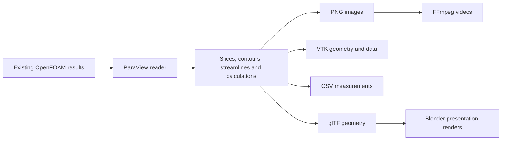

# CFD workflows with Schemaxis

Start here if you want to turn a CFD result into repeatable plots, geometry files,
measurements and videos.
You can begin by editing a JSON input; you do not need to understand the Python
implementation first.

**For the complete from-scratch walkthrough, read
[From a completed OpenFOAM case to repeatable ParaView outputs](docs/cfd-postprocessing.md).**
It includes the execution-flow diagram, four copyable inputs, reusable case settings,
slice spacing, camera windows, variables/colours and a
[CFD-focused operation directory](docs/cfd-operations.md).

For installation, runtime paths and qualification, see the
[CFD guide](docs/cfd-guide.md). This page explains what to try and how
an input works.

## 1. CFD results → ParaView pipeline → many outputs

Schemaxis describes the pipeline in JSON and runs it in ParaView's `pvbatch`.
The JSON is an Schemaxis input, not a ParaView `.pvsm` state file. Native
applications run in separate processes; Schemaxis retains the input, plan,
outputs and verification evidence.



Different examples select different branches of this diagram. Video needs FFmpeg;
Blender rendering also needs Blender. Scientific arrays and geometry are not
necessarily preserved in presentation formats such as glTF or video.

### First run

From the repository root, install the host package with Python 3.10 or newer:

```bash
python3 -m venv .venv
. .venv/bin/activate
python -m pip install .
schemaxis discover
schemaxis plan examples/schemaxis/branching.json
```

That last input uses synthetic data, so it can be planned without a CFD case or
ParaView installation. To execute it, provide ParaView:

```bash
mkdir -p evidence
schemaxis run examples/schemaxis/branching.json \
  --paraview-root /absolute/ParaView \
  --output-directory evidence/first-pipeline
schemaxis verify evidence/first-pipeline
```

Choose a fresh output directory for each run. `plan` checks the description;
`run` produces and checks native outputs; `verify` rechecks retained evidence.
Verification does not certify the CFD solution's physical correctness.

### Use your CFD results

Start with the [vehicle input](examples/demos/vehicle.input.json). It gathers
measurements in `dimensions`, camera/framing choices in `views`, and case, field,
patch and output choices in `settings`. Before running, adapt the fields, patch
groups, geometry bounds and coordinate assumptions to your case. The vehicle case
it was prepared for is not distributed; changing the case path alone does not adapt those
other settings.

```bash
export SCHEMAXIS_DEMO_PARAVIEW_ROOT=/absolute/ParaView
export SCHEMAXIS_DEMO_CASE=/absolute/case/case.foam
python3 examples/demos/demo.py doctor vehicle
python3 examples/demos/demo.py plan vehicle
python3 examples/demos/demo.py run vehicle
python3 examples/demos/demo.py show vehicle
python3 examples/demos/demo.py paths vehicle
```

The `.foam` marker and the underlying case data must be accessible. `doctor`
checks paths, not compatibility or CFD validity. The helper creates dated outputs
under `evidence/demos`, retaining `input.json`, `run.log` and `verify.log`.
`show` opens the latest successful run's gallery; `paths` lists useful outputs.

The input selects the latest solution time. Pure planning cannot inspect that
native metadata: the helper uses time 1.0 only as a planning placeholder. `run`
and `export` preserve latest-time discovery. Direct `schemaxis plan` on a
latest-time input can return `TIME_INSPECTION_REQUIRED`; this is expected.

For movies, configure `SCHEMAXIS_DEMO_FFMPEG=/absolute/bin/ffmpeg`, with its matching
FFprobe installed, then run `python3 examples/demos/demo.py movies vehicle`.
To see the actual configured JSON for the normal CLI:

```bash
python3 examples/demos/demo.py export vehicle
schemaxis run evidence/demos/inputs/vehicle.json \
  --paraview-root "$SCHEMAXIS_DEMO_PARAVIEW_ROOT" \
  --output-directory evidence/my-cfd-run --timeout 600
schemaxis verify evidence/my-cfd-run
```

### Demo map

| Start here | What to learn or produce |
| --- | --- |
| [Synthetic branching pipeline](examples/schemaxis/branching.json) | No case required: slices and contours, parameter combinations, multiple appearances/cameras, images and geometry. |
| [Vehicle input](examples/demos/vehicle.input.json) and [demonstration guide](examples/demos/README.md#4-vehicle-and-wake-paraview--images--ffmpeg) | `run vehicle`: X/Y/Z slice sweeps, pressure/speed views, iso-surface orbit and streamline seed sweep. `movies vehicle` encodes the images. |
| [Local-region/mirror input](examples/demos/mirror.input.json) | `run region`: configurable region study, local views and velocity sampling. The supplied geometry has no identified mirror; `run mirror` requires measured bounds and explicit confirmation. |
| [CFD presentation workflow](examples/demos/README.md#6-cfd-results--paraview--blender--ffmpeg) | `run cfd-render`: ParaView extraction → glTF → Blender orbit → FFmpeg movie. Requires ParaView, Blender and FFmpeg. Export it with `demo.py export cfd-render`. |
| [Dimension-driven authoring](docs/human-input.md) | How measurements drive framing and repeated views through `$document` and `$value`. |
| [OpenFOAM pipeline with runtime observations](examples/schemaxis/foam.json) | Read `U`/`p`, calculate speed, position slices from native bounds and publish multiple appearances. The case is not distributed: edit its `file` entry to point at your own `.foam` marker. |
| [Two-rank CFD workflow](examples/schemaxis/foam-native-parallel.json) | Advanced: distributed geometry and integrated measurements. Configure the case and a matching MPI launcher; start with serial acceptance first. |

The [full demonstration guide](examples/demos/README.md) also covers CAD/mesh
inspection. The helper's `--help` lists runtime options; all examples require their
own external applications. Recorded ParaView qualification used 5.13.3 and bounded
real-case/MPI checks; your target version and representative cases need acceptance.

## 2. Read a pipeline and find the schema

For a single ParaView pipeline, keep `"version": "schemaxis/1"`; this is the stable
format identifier even though the product and command are named Schemaxis.

| Input part | Meaning |
| --- | --- |
| `dimensions`, `settings`, `views`, `definitions` | Named authored data reused elsewhere in the same document. |
| `nodes` | Reader/filter definitions. Each has an `id`, `filter`, optional `options` and upstream `inputs`. |
| `times` | Which solution times to visit: explicit values or a native inspection selector. |
| `axes` or inline `$analytic` | Parameter variations such as slice positions or contour levels. |
| `scenes` | Publication requests: visible objects/styles, geometry exports, measurements, images and cameras. |
| `maxPublications` | A bound on output expansion; keep initial sweeps small. |

For example, `"inputs": {"input": "flow"}` connects a filter to the node named
`flow`. It passes a native pipeline object, not a filename. Multiple output
requests can use shared upstream nodes. Independent variations combine where
those outputs depend on them, so adding times, slices, appearances and cameras
can multiply the number of publications.

**The ParaView authored schema is [here](docs/generated/paraview.authored.schema.json).**
It describes Schemaxis's supported input contract, not every possible ParaView
Python API call. The files below are generated from the implementation:

| Reference | When to use it |
| --- | --- |
| [ParaView authored JSON schema](docs/generated/paraview.authored.schema.json) | Editing inputs with references, expressions and supported analytics. |
| [ParaView expanded JSON schema](docs/generated/paraview.schema.json) | Inspecting the contract after authoring expansion. |
| [Readable ParaView operations](docs/generated/paraview-operations.md) | Find a filter, its input ports, options and constraints without reading a large schema. |
| [Analytics schema](docs/generated/analytic.authored.schema.json) | Inline sequences; [expanded form](docs/generated/analytic.schema.json) is also available. |
| [Composition schema](docs/generated/composition.schema.json) | `$document`, `$expr` and `$value` authoring forms. |
| [Settings and typed functions](docs/generated/settings.md) | Function arguments/results and presentation settings. |
| [Workflow schema](docs/generated/workflow.authored.schema.json) | Several application operations connected by published artifacts. |
| [Editor setup](docs/schema-guide.md#editor-setup) and [JSON input guide](docs/json-input.md) | Schema association, supported scopes and complete input syntax. |

For a complete `input.json` such as the vehicle example, associate **only the
ParaView authored schema** with that file. It already includes analytics,
`$document`, `$expr`, `$value` and the supported runtime forms. The analytics and
composition files describe individual expression fragments; they are references,
not additional schemas to associate with the whole pipeline. In particular,
`analytic.authored.schema.json` expects a value such as
`{"$analytic":{"type":"linear","start":0,"end":1,"count":3}}`, so it correctly
rejects a complete document beginning with `"version": "schemaxis/1"`.
For a project containing several application document types, use
[the authored umbrella](docs/generated/schemaxis-authored.schema.json) instead.

The generated JSON files are compact and can be large. Use the readable references
or export indented JSON for browsing:

```bash
schemaxis schema --authored --provider paraview | python -m json.tool > evidence/paraview-authored.schema.json
schemaxis schema --authored --section analytic | python -m json.tool > evidence/analytic.schema.json
schemaxis schema --section composition | python -m json.tool > evidence/composition.schema.json
schemaxis describe slice
schemaxis functions
```

Schema validation checks structure. Planning additionally checks dependencies,
references and supported combinations. Native execution checks actual files,
fields, application properties and outputs.

## 3. References, expressions and analytics

These have different purposes. None is arbitrary Python. The following are JSON
**fragments**, not complete runnable documents.

### Reuse authored values: `$document`

Put the case path in one place and refer to it from reader options:

```json
{
  "settings": {"case": "/absolute/case/case.foam"},
  "nodes": [{
    "id": "flow", "filter": "foam",
    "options": {"file": {"$document": "/settings/case"}, "cellArrays": ["U", "p"]}
  }]
}
```

The pointer addresses this JSON document. It retains the target's type, so it can
supply a number, array or whole options object. It does not load another file or
refer to a native ParaView object. Missing targets and reference cycles fail.

### Compute from authored data: `$expr` and `$value`

`$expr` combines authored values with arithmetic or object/array operations:

```json
{"$expr": {"op": "add", "args": [{"$document": "/dimensions/ground"}, 0.35]}}
```

`$value` calls a registered typed function with named arguments. For example,
this returns the centre of your declared model bounds:

```json
{"$value": "boundsCentre3D", "args": {"bounds": {"$document": "/dimensions/model"}}}
```

Here `dimensions.model` is `{"min":[0,0,0],"max":[4,2,1]}`; the centre is
`[2,1,0.5]`. `$value` is a function evaluation, not a reference to a native object.
The vehicle example uses `boundsExtend`, `boundsFrame`, `slicePositions` and
camera helpers to derive views from measurements. Both `$expr` and `$value`
resolve before graph execution. See [authored calculations](docs/json-input.md#10-document-reuse-and-authored-calculations).

### Visit several values: `$analytic`

In a slice node's options, sweep Z while keeping X and Y fixed:

```json
{"origin": [0, 0, {"$analytic": {"type": "linear", "start": 0.1, "end": 0.5, "count": 3}}],
 "normal": "z+"}
```

This visits Z = 0.1, 0.3 and 0.5. It varies a parameter; it does not fit a function
to your CFD data. Analytics also support declared value lists and camera orbits
in supported scopes. Repeated analytics with the same `sync` name advance
together; independent ones create combinations where used together. An explicit
named `axes` array with `$axis` references is another way to declare variations.
See [parameter variations](docs/json-input.md#4-vary-a-parameter).

### Read native results at runtime

| Form | Meaning |
| --- | --- |
| `{"$observe":"flow","path":["bounds"]}` | Read the current native dataset's six-value bounds. |
| `{"$call":"boundsCentre","args":{"bounds":{"$observe":"flow","path":["bounds"]}}}` | Compute the centre from native bounds, using named arguments. |
| `{"$calc":"midpoint","args":[{"$observe":"flow","path":["bounds"]}]}` | The corresponding runtime calculation using positional arguments. |
| `{"$sample":"probe","association":"POINTS","field":"p","index":0}` | Read a field tuple from an upstream node named `probe`; it must exist and provide that array/association. |
| `{"$time":true}` / `{"$axis":"height"}` | Current solution time / named variation value. |

Authored `boundsCentre3D` above accepts `{min,max}`; runtime `boundsCentre` accepts
`[xmin,xmax,ymin,ymax,zmin,zmax]`. Choose the contract matching your data.
Runtime references create upstream dependencies and are supported only in the
scopes described in [runtime values](docs/json-input.md#11-runtime-values-and-observations).
A tuple index is not a persistent physical location.

For a **multi-application** `schemaxis.workflow/1`, `{"$artifact":"extract","index":0}`
selects an output file from the earlier operation `extract`. Check its ordered
artifact receipt and required kind; do not guess indices. This is the bridge used
by the CFD-to-Blender demo. See [workflows and verification](docs/json-input.md#12-workflows-files-and-verification).

## 4. Case preparation, meshing and solving

Schemaxis does not ship an adaptor that prepares a CFD case, generates a CFD mesh or
runs a solver; the workflows above start from completed results. A preparation or
solver provider can be developed and installed separately as an
[external adaptor package](docs/adaptor-development.md). Such a provider should
keep its own contract for each operation: typed options, dependency rules, the
native call, readback after save/reopen and useful failures. Meshing and solving
need explicit completion/failure and quality checks; a process exit or saved file
alone is insufficient. Establish a case-bundle contract before passing prepared
cases between applications. See the [adaptor development guide](docs/adaptors.md).

When reporting a result, include the input, exact runtime versions, case assumptions,
output/verification directory and what was actually checked. Keep host test success,
native acceptance and physical validation distinct.
