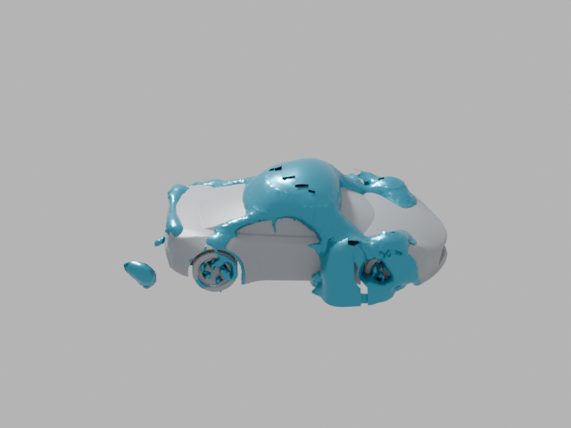

# Schemaxis

**Declared, repeatable pipelines across engineering and creative desktop
applications, for people and AI agents, with retained evidence used to check
each result.**

<p align="center">
  
</p>
<p align="center"><sub>One recorded run: ParaView extracts a surface from a
1.23-million-cell OpenFOAM case, Blender renders an orbit, and FFmpeg encodes the
movie. Every image is retained with its SHA-256 digest.
<a href="docs/release-evidence.md">How it was produced</a>.</sub></p>

You describe the work in JSON or YAML: build this CAD part, mesh it with named
boundary faces, and measure the mesh in ParaView. Schemaxis checks the
description against each application's declared contract and plans it without
starting anything. It then runs each step in the real native application,
in its own process, and keeps the plan, the editable files, the logs and the
verification receipts. If a result fails its checks, nothing downstream is
published as if it had succeeded.

```text
FreeCAD  ──STEP──▶  Gmsh  ──MSH/VTU──▶  ParaView
  editable FCStd      named faces         measured volume and cell sizes
  ✔ reopened          ✔ verified          ✔ checked against the declared solid
```

Schemaxis is a public preview (0.x). Input contracts may still change between
minor versions; migration notes are in the [changelog](CHANGELOG.md).

## Why

- **One language across applications.** A single declared document format,
  with schemas, editor completion and planning, across the registered applications.
- **Native results, not imitations.** Every step runs in the application's own
  runtime: pvbatch, Blender in the background, FreeCAD, Gmsh Python, ngspice and
  so on. You get the files those applications would make.
- **Evidence you can check.** Runs keep their inputs, artifacts, logs and
  digests. `schemaxis verify` rechecks a retained run. Many adaptors add
  independent checks, such as beam theory, closed-form circuit responses,
  analytic volumes and frame-by-frame decoding.
- **Resume without redoing, and without mixing.** Rerunning an unchanged workflow
  with `--resume` reuses each completed job whose inputs can be proven unchanged,
  and records which were reused; jobs whose external inputs cannot be fingerprinted,
  such as ParaView case readers, run again. A changed workflow is refused for
  resume, not quietly mixed with old results.
- **Built for AI agents as well as people.** Agents get the same discovery,
  description, planning and verification as humans, through the CLI or a local
  JSON-lines agent service. In our ParaView pilot, smaller models that failed
  the task on their own passed every check when they used Schemaxis. Frontier
  models did not need it, and were slower with it. See the
  [measured results](https://schemaxis.io/measured-results.html) and their limits.

## Install

Schemaxis needs Python 3.10 or newer and has no runtime dependencies.

```bash
git clone https://github.com/schemaxis/schemaxis.git
cd schemaxis
python3 -m pip install .         # or: python3 -m pip install '.[yaml]' for YAML
schemaxis discover              # list every adaptor and its contract
```

Install from the source repository for this preview. A PyPI package release is
separate from publication of the repository.

From a source checkout, without installing:

```bash
git clone https://github.com/schemaxis/schemaxis.git
cd schemaxis
export PYTHONPATH=src
python3 -m schemaxis discover
```

The applications themselves are installed separately. Record where they are
once with `schemaxis configure`. See [installation](docs/installation.md).

## Five minutes, no applications needed

```bash
schemaxis describe --provider freecad               # operations and options
schemaxis plan examples/schemaxis/freecad-bracket.json
```

`plan` validates the document and resolves every option without starting
FreeCAD. Change a value in the example to something invalid and plan again:
the fault names the field and explains how to fix it. When FreeCAD is
configured, `schemaxis run` performs the work and `schemaxis verify` rechecks it.
The [ten-minute walkthrough](docs/getting-started.md) continues from here.

For interactive work, Schemaxis Studio runs locally in your browser:

```bash
schemaxis console --workspace .schemaxis/studio --web
```

## Applications

| Area | Applications |
| --- | --- |
| CFD and data post-processing | ParaView (serial and MPI pvbatch, OpenFOAM-format cases) |
| CAD, meshing and structures | FreeCAD, Gmsh, CalculiX, meshio (bounded VTU/VTK interchange), OpenSCAD (dimensioned plates and spacers) |
| Numerical analysis | GNU Octave, R, Cantera, ngspice |
| PCB inspection | KiCad |
| Fabrication | PrusaSlicer |
| Scientific imaging | ImageJ, ImageMagick (bounded PNG preparation and comparison sheets) |
| Spreadsheets | LibreOffice Calc (ODS and XLSX) |
| Reports | Pandoc (structured reports to HTML and DOCX) |
| Data and plots | SQLite (typed relational summaries), Apache Arrow (typed nullable CSV to verified Parquet), Gnuplot (CSV plots with checked geometry) |
| PDF assembly and review | QPDF (selected pages, order, repeats and quarter turns), MuPDF (ordered page images, text and geometry) |
| 3D, games and pixel art | Blender, Godot, Aseprite |
| Diagrams, video and media | Inkscape, FFmpeg, Shotcut, Adobe Premiere Pro (experimental, read-only) |
| Directed graph layout | Graphviz (checked DOT/SVG layout) |
| Audio | SoX (PCM16 excerpts, gain, fades and concatenation) |
| Geospatial | QGIS, GDAL (checked raster windows and nearest grid resizing) |

Each adaptor declares its bounded scope, so it is explicit about what it does
*not* do. Run `schemaxis discover` for the details, or see the
[coverage report](docs/coverage.md). Adaptors can also be installed as separate
packages: see "External adaptor packages" in the
[adaptor development guide](docs/adaptor-development.md).

## Documentation

- [Getting started](docs/getting-started.md) and the [user guide](docs/user-guide.md)
- [JSON input reference](docs/json-input.md), [YAML authoring](docs/yaml.md) and the [schema guide](docs/schema-guide.md)
- [Studio](docs/visual-console.md) and [console commands](docs/console.md)
- [CLI and topic help](docs/cli-discovery.md), [headless operation](docs/headless.md),
  [shared schemas](docs/schema-storage.md) and [storage inspection/backups](docs/storage-management.md)
- [Guide for AI agents](docs/ai-guide.md) and the [agent service](docs/agent-service.md)
- [CFD post-processing with ParaView](docs/cfd-guide.md)
- [Workflow benchmarks and reproducibility](docs/benchmarks.md), and [release evidence](docs/release-evidence.md)
- [Capabilities in detail](docs/capabilities.md) and the [quick reference](docs/quick-reference.md)
- [Checked FreeCAD imports and exports](docs/freecad.md), [parametric parts](docs/freecad-part-design.md)
  and [fixed assemblies](docs/freecad-assemblies.md)
- [Developer guide](docs/developer-guide.md) and [adaptor development](docs/adaptor-development.md)

## Platform support

Schemaxis is developed and natively qualified on Linux x86-64. macOS and Windows
are not yet supported: the host framework is pure Python, but parts of it still
assume a POSIX system, and no native adaptor has been qualified there.

## Contributing

Issues and pull requests are welcome. See [CONTRIBUTING.md](CONTRIBUTING.md)
and [AGENTS.md](AGENTS.md). Please report security issues privately, as
described in [SECURITY.md](SECURITY.md).

Schemaxis was conceived, designed and developed by David L. F. Gaden, with the
help of AI coding assistants working under his direction and review.

## Licence

Copyright © 2026 David L. F. Gaden. Licensed under the
[Apache License 2.0](LICENSE). Third-party material keeps its own licence: see
[NOTICE](NOTICE) and [LICENSES/](LICENSES).

Core and Studio include general-purpose database adaptors, geometry, meshing,
local case files and workflow execution. Integrated database-backed case/history
services and CFD solver/case-preparation integrations are separate components.
See [Distribution boundary](docs/distribution.md).

"Schemaxis" is a trademark of David L. F. Gaden (application pending). See
[TRADEMARKS.md](TRADEMARKS.md). ParaView, Blender, FreeCAD and the other
application names are trademarks of their respective owners. Their use here
does not imply endorsement.
