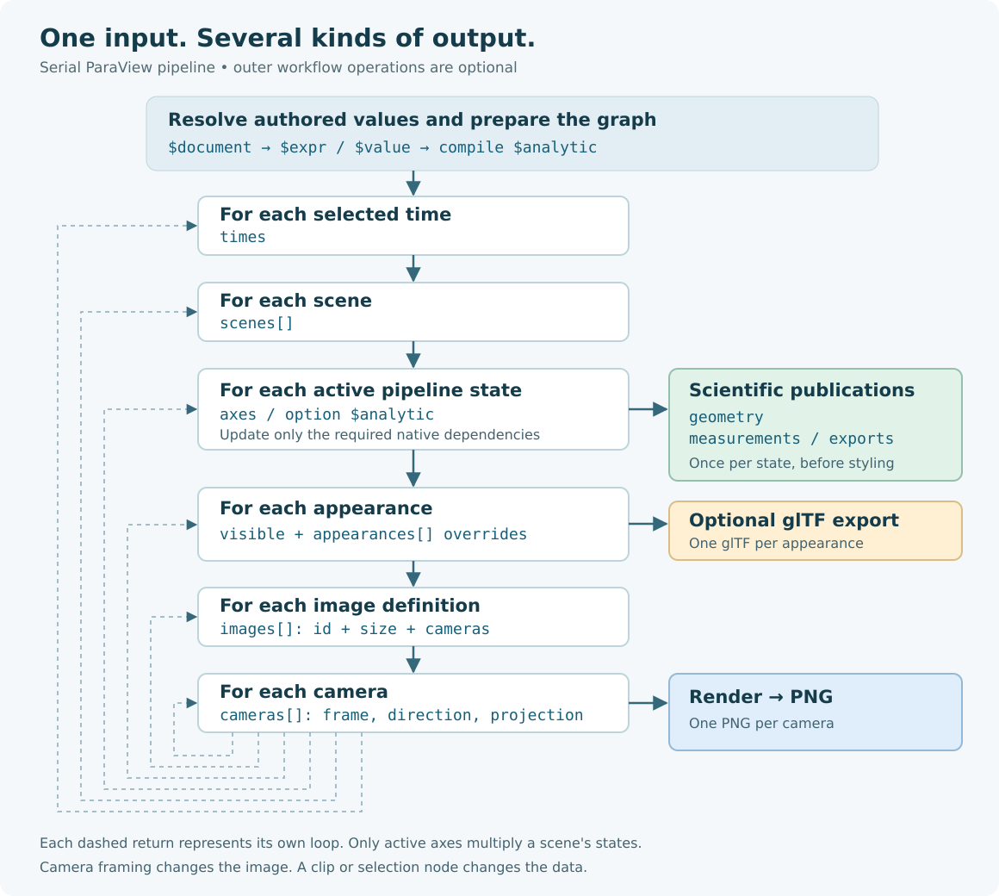

# From a completed OpenFOAM case to repeatable ParaView outputs

This guide starts with a completed OpenFOAM-format case on disk and ends with a
reusable Schemaxis `input.json` that produces images, slices, iso-surfaces,
streamlines and numerical exports. You do not need to write Python or operate the
ParaView GUI to describe the pipeline.

**Start small:** read one known solution time, inspect its fields, make one image,
then add filters and variations. The downloadable examples below are complete
inputs; their case paths, times and dimensions are placeholders you must adapt.

- [First read: one case, one image](../examples/cfd-postprocess/01-read-case.json)
- [Reusable multi-output template](../examples/cfd-postprocess/02-reusable.json)
- [Slices at a specified spacing](../examples/cfd-postprocess/03-spaced-slices.json)
- [Streamline template](../examples/cfd-postprocess/04-streamlines.json)
- [CFD operation directory: readers, filters and writers](cfd-operations.md)
- [Runtime installation and qualification boundaries](cfd-guide.md)

## Contents

1. [Prepare the case and the two Python environments](#1-prepare-the-case-and-the-two-python-environments)
2. [Make your first input and run it](#2-make-your-first-input-and-run-it)
3. [Understand the execution sequence](#3-understand-the-execution-sequence)
4. [Build a pipeline, one node at a time](#4-build-a-pipeline-one-node-at-a-time)
5. [Turn the input into a reusable case template](#5-turn-the-input-into-a-reusable-case-template)
6. [Sweep slices and other parameters](#6-sweep-slices-and-other-parameters)
7. [Choose windows, cameras, variables and colours](#7-choose-windows-cameras-variables-and-colours)
8. [Publish geometry, tables and other formats](#8-publish-geometry-tables-and-other-formats)
9. [Select times and keep output counts manageable](#9-select-times-and-keep-output-counts-manageable)
10. [Inspect results and solve common problems](#10-inspect-results-and-solve-common-problems)
11. [Continue with the existing demonstrations](#11-continue-with-the-existing-demonstrations)

## 1. Prepare the case and the two Python environments

### What must be present

Schemaxis reads existing results; this workflow does not launch a solver. Keep the
mesh, boundary descriptions and required field files alongside the solution times.
A typical reconstructed case looks like this:

```text
completed-case/
  case.foam                 ← reader entry point; usually an empty marker
  system/
    controlDict
  constant/
    polyMesh/               ← mesh, including boundary definitions
  0/                        ← initial fields, not necessarily the solved state
  1/                        ← example saved solution time; use your real time
    U
    p
    ...
```

For a decomposed case, mesh/field data instead lives under `processor0`,
`processor1`, and so on, or a format-specific processor layout. Keep the complete
case tree. Sending only `case.foam` sends no mesh or solution.

Use an existing `.foam` marker where available. If none exists and your selected
reader supports this layout, create an empty marker **inside the case root**:

```bash
touch /absolute/path/to/completed-case/case.foam
```

This adds a reader entry point, not a converted dataset. Confirm the chosen
ParaView release can read your output format. Cases from OpenFOAM-derived codes,
such as HELYX, often read the same way, but similarity to OpenFOAM does not
establish compatibility for every release, binary format, multi-region case or
processor layout.

### Set the case type explicitly

| Your stored results | `foam.options.caseType` |
| --- | --- |
| Reconstructed mesh and fields in the case's ordinary directories | `"Reconstructed Case"` |
| Partitioned mesh/fields under processor directories | `"Decomposed Case"` |

The convenience `foam` reader defaults to **Decomposed Case**, so the examples
set this explicitly. Reading a decomposed case in one serial `pvbatch` process
does not mean ParaView is running under MPI. Start serial; see the
[parallel guide](parallel-execution.md) for deliberate distributed execution.

ParaView's OpenFOAM reader exposes case type, region and array selections and
produces a multiblock dataset. Its native options also include label/scalar size
and zone reading. The short Schemaxis alias exposes a smaller set; use
`pvOpenFOAMReader` when you need a supported extra option, with its exact declared
spelling. [ParaView 5.13.3 reader reference](https://www.paraview.org/paraview-docs/v5.13.3/python/paraview.simple.OpenFOAMReader.html).

### Install Schemaxis; point it to ParaView separately

From your Schemaxis clone:

```bash
python3 -m venv .venv
. .venv/bin/activate
python -m pip install .
schemaxis discover
```

The host Python plans the work. A separate ParaView installation supplies
`bin/pvbatch` and its own Python/VTK environment for execution. Installing
Schemaxis into your virtual environment does not install ParaView. Use an explicit
root such as `/absolute/ParaView` with `--paraview-root`; no PATH change is needed.
The recorded ParaView qualification used 5.13.3. Accept other target installations
against representative cases before relying on them.

## 2. Make your first input and run it

### Create a study folder

Choose a fresh folder outside the source tree for your own inputs and outputs.
From the repository root, for example:

```bash
mkdir -p ../my-cfd-post
cp examples/cfd-postprocess/01-read-case.json ../my-cfd-post/input.json
cd ../my-cfd-post
mkdir -p results
schemaxis schema --provider paraview --authored > paraview.authored.schema.json
```

In VS Code, open this study folder and create `.vscode/settings.json`:

```json
{
  "json.schemas": [{
    "fileMatch": ["/input.json"],
    "url": "./paraview.authored.schema.json"
  }]
}
```

Use the **whole-document ParaView authored schema**. It includes `$document`,
`$value`, `$expr`, `$analytic` and supported runtime expressions. Do not associate
`analytic.authored.schema.json` with a complete input; it describes one expression
and therefore expects `$analytic` at the root. Do not add `$schema` to the input
itself: Schemaxis rejects that unknown root key. More [editor setup](schema-guide.md#editor-setup).

### Edit the case-specific settings

The first template reads `internalMesh`, merges its blocks, colours the mesh by
velocity magnitude and publishes one PNG. Change these settings before execution:

```json
"settings": {
  "case": "/absolute/path/to/completed-case/case.foam",
  "caseType": "Reconstructed Case",
  "times": [1.0],
  "velocity": "U",
  "pressure": "p"
}
```

`1.0` is an example, **not an instruction to choose time 1 for every case**. Enter
a saved solution time actually present in your case. Steady solver time-directory
names may represent iteration progress. Use the stored numeric directory, not a
wall-clock time or an assumed final value from `controlDict`. The template asks
the reader for `U` and `p`; change these names, or remove an unnecessary field from
`cellArrays`, if your case stores something else.

The template's top-level `times` is a `$document` reference to `settings.times`.
The reader's file, case type and field list use the same mechanism. You edit these
values once, instead of editing every downstream use.

### Plan, inspect, run, verify

```bash
schemaxis plan input.json > results/first-plan.json
schemaxis inspect input.json --node mesh \
  --paraview-root /absolute/ParaView \
  --output-directory results/mesh-inspection --timeout 300
schemaxis run input.json \
  --paraview-root /absolute/ParaView \
  --output-directory results/first-image --timeout 600
schemaxis verify results/first-image
```

- `plan` is host-only: it checks the declared graph and reports publication counts.
  It cannot prove a file exists, a field is available or a native operation works.
- `inspect` launches ParaView for the requested node and its upstream dependencies,
  without rendering an image. Read `results/mesh-inspection/inspection.json` for
  observed bounds, point/cell counts, field associations and ranges.
- `run` performs native execution, publishes requested outputs and checks them.
- `verify` rechecks the retained plan, ordered artifact membership and evidence.
  It is not a new solver run or a physical validation of the CFD result.

Each native command needs a **new output directory**. Create its parent (`results`)
first. If a run fails, keep its logs and retry into a different directory.

Start with an explicit time for `plan` and `inspect`. Automatic latest-time
selection is described in [section 9](#9-select-times-and-keep-output-counts-manageable);
CLI `inspect` does not perform that automatic time-discovery step.

## 3. Understand the execution sequence

Description of names in the flow diagram:

| Schemaxis Term | Description |
| --- | --- |
| `operation` | One entry in `schemaxis.workflow/1.operations`, if using a multi-application workflow. A plain `schemaxis/1` input already describes one ParaView pipeline. |
| `times` | The user-selected list of `times` from output case directory. |
| `scene` | The requested visible objects and outputs. |
| `scene state` | One configuration of visible objects whose visible configuration can change, either through *analytics* or internal properties. `scene state` cycles via a counting algorithm to guarantee all *states* are visited. Objects synchronised with to the same `sync` label change state in unison. |
| `measurements` | Dimensional outputs, written once per `scene state`. |
| `geometry`  | Other geometry-derived outputs, written once per `scene state`. |
| `exports` | Geometry-related exports, such as `STL`, written once per `scene state`. |
| `appearance` | Overrides to the `scene`'s base visible styles. |
| `images` | Output specific to screenshots, `images` coupled with its camera list to produce PNGs. Other file writers instead belong to `exports`. |



For a serial ParaView pipeline, the order is:

```text
Resolve $document / $expr / $value; compile analytics and validate the graph
Resolve selected source times natively if requested by run
For each selected time:
  For each scene, in document order:
    For each viable scene state:
      Create/reuse and update the required reader/filter objects
      Write geometry, measurements and declared exports
      For each appearance:
        Apply visible styles
        Write glTF if requested
        For each image definition:
          For each camera:
            Render and save a PNG
```

A node is one reader or filter, not an outer workflow operation. Native objects
can be shared and reused; a new appearance or camera does not mean all filters
are rebuilt. Nodes not needed by an output or one of its dependencies are pruned.
Only changeable elements (either via internal state changes or configuration changes driven by *analytics*) active in that scene's dependencies multiply its states. This matters:
a slice sweep need not multiply a separate iso-surface scene.

A scheduled multi-operation/MPI workflow can dispatch work differently, but still
retains explicit publication identities. Use the ordered receipt to identify
outputs rather than assuming lexicographic filenames express visit order.

## 4. Build a pipeline, one node at a time

A reader/filter node has a name, a declared operation and options:

```json
{
  "id": "cut",
  "filter": "slice",
  "inputs": {"input": "mesh"},
  "options": {"origin": [0, 0, 0.5], "normal": "z+"}
}
```

`id` is your chosen name. `filter` must be a registered operation. The input
`"mesh"` connects to that node's native output. It is not a path or `$document`
reference. Options are typed; unknown names and unsupported values are rejected.
Use `schemaxis describe slice` to see exact options and defaults.

The [reusable template](../examples/cfd-postprocess/02-reusable.json) builds:

```text
case [foam] → mesh [merge] ┬→ domainOutline [outline]
                          ├→ cut [slice] → slice images + geometry
                          ├→ points [cellToPoint] ┬→ pressureIso [contour]
                          │                      └→ sample [probeLine]
                          └→ totals [integrate]
```

### The first useful CFD operations

| Goal | Start with | What to check |
| --- | --- | --- |
| Read the fluid volume | `foam` → `merge` | Explicit case type, time, `internalMesh`, requested fields. |
| Planar cross-section | `slice` | Origin, normal and whether the plane intersects fluid. |
| Remove part of a volume | `clip` | Plane orientation and `invert`; this changes data, not just framing. |
| Keep a value interval | `threshold` | `field`, `lower`, `upper`, association and physical meaning. |
| Pressure/temperature iso-surface | `cellToPoint` → `contour` | Point scalar field, iso-values within range; interpolation can smooth the field. |
| Streamlines | `cellToPoint` + `line` seed → `streamTracer` → `tube` | Vector association, seed locations, maximum length and visual tube radius. |
| A velocity/pressure profile | `probeLine` → `measurements` | Line endpoints, resolution and valid sample locations. |
| Area/volume integrals | `integrate` → `measurements` | The selected domain and field units; an integral is not automatically an average. |
| Derived fields | `calculator`, `gradient` or `pvGradient` | Expression, result name and array association; inspect native options for vorticity/Q/divergence. |
| Body/wall pressure | A separate `foam` reader with actual patch names | A wall patch is not the same as the outer surface of the whole fluid volume. |

For the much wider set, use the [CFD operation directory](cfd-operations.md). It
includes CFD formats, sampling, particle paths, temporal analysis, mesh quality,
AMR and writers. These are declared candidates, not an assertion that each has
been natively accepted on your case.

### Cell data, point data and associations

Finite-volume fields commonly arrive as cell arrays. A style or filter field is
usually written `['CELLS', 'p']` or `['POINTS', 'U']` in explanation; actual JSON
uses double quotes: `["CELLS", "p"]`. `component: -1` selects vector magnitude;
components `0`, `1`, `2` select X, Y, Z for a three-component vector.

Use the field association actually observed at the node being coloured or sampled.
`cellToPoint` explicitly creates interpolated point data for operations that need
it. This changes where values are represented and may affect discontinuities.
Never infer the physical units from the field name alone. In particular, `p`
can mean kinematic pressure rather than pressure in Pa; inspect the saved field
header and solver conventions before labelling or deriving coefficients.
[OpenFOAM pressure conventions](https://doc.openfoam.com/2312/tools/processing/solvers/algorithm-kinematic-pressure/).

The `calculator` alias uses ParaView's expression syntax, such as `mag(U)`, with
`"association": "Cell Data"` or `"Point Data"`. This is distinct from Schemaxis's
`$expr` authoring operations. A result array name becomes available only downstream
of its calculator node.

### Boundary patches and composite structure

The main template deliberately starts with `internalMesh` only. For body context
or wall pressure, add a second reader using the **actual** available patch region
names, then merge only those selected regions. For example, this is a node fragment
for a case whose reader really exposes a region named `body`:

```json
{
  "id": "wallReader", "filter": "foam",
  "options": {
    "file": {"$document": "/settings/case"},
    "caseType": {"$document": "/settings/caseType"},
    "regions": ["body"],
    "cellArrays": [{"$document": "/settings/pressure"}]
  }
}
```

Follow with `{"id":"walls","filter":"merge","inputs":{"input":"wallReader"}}`.
Add `walls` to a scene's `visible` mapping to display it. Do not guess patch names
or load all domain walls when you intend to show the internal body. Reader region
names and `extractBlock` hierarchy selectors are different contracts. Select
blocks before a merge if you need their identities later. A latest-time run
retains the reader's available `regions` and `cellArrays` in `inspection.json`;
node inspection reports the selected data, not a universal patch-selector browser.

## 5. Turn the input into a reusable case template

Copy [02-reusable.json](../examples/cfd-postprocess/02-reusable.json) into a new
study input after the first reader check succeeds. Its case-specific values are
concentrated at the top:

| Section | Change for a similar new case |
| --- | --- |
| `settings` | Case path/type, solution times, velocity/pressure field names, ranges, iso-value, slice/orbit counts, image size, seed settings. |
| `dimensions.model` | Measured body/region min/max bounds. Used for framing, not automatic body detection. |
| `dimensions.sliceBounds` | The interior region over which slices are positioned. Keep endpoints away from unsuitable outer boundaries. |
| `dimensions.detail` | A smaller region to frame in the detail images. |
| `dimensions.sampleLine` | Valid-fluid endpoints for the line sample. |
| `dimensions.sliceSpacing` | Spacing used by the separate fixed-spacing template. |
| `views` | Derived framing definitions, normally reusable for similarly oriented cases. |
| `nodes`, `scenes` | Reusable processing/publication logic, provided the new case meets its assumptions. |

The example assumes XYZ coordinates with Z up. All coordinates and lengths use
the case's units. Replace the illustrative dimensions; the template does not find
the car, wall, wake, mirror or fluid region for you. Different field names,
coordinate conventions, regions or physics can require pipeline edits as well.

### `$document`: reuse a value from this document

```json
{"$document": "/settings/case"}
```

This substitutes the value stored at that JSON Pointer. It preserves its type:
a string remains a string; bounds remain an object; a list remains a list. You
can reference an entire options/style object as well as a scalar. It does not
read another file, expand shell variables or obtain a native ParaView object.
Use absolute paths in resource strings rather than assuming `~` or `$HOME` expands.

Missing targets and cycles fail. `./` and `../` references are also supported at
the marker's definition site, but absolute document pointers are easier to follow
in a first template. If a JSON key contains `/` or `~`, escape it as `~1` or `~0`.

### `$value`: calculate a typed value from authored data

```json
{
  "$value": "boundsExtend",
  "args": {
    "bounds": {"$document": "/dimensions/model"},
    "before": [0.5, 1, 0],
    "after": [1.5, 1, 0.5]
  }
}
```

This expands the original model bounds by fractions/multiples of their X/Y/Z
extents. `after: [1.5,1,0.5]` adds 1.5 original lengths on +X, one original width
on +Y and half the original height on +Z. These are not absolute distances.
Store the result in `views.overview` and reference it from camera definitions.

Useful functions include `boundsCentre3D`, `boundsSize`, `boundsExtend`,
`boundsUnion`, `boundsFrame`, `slicePositions`, `fitCamera` and `orbitCameras`.
`$value` runs a declared pure function before native graph execution; it is not a
reference to an already-executed filter. See `schemaxis functions` and the
[typed settings/function reference](generated/settings.md) for arguments/results.

### `$expr`: small arithmetic and composition

```json
{"$expr": {"op":"add", "args":[{"$document":"/dimensions/model/min/2"}, 0.1]}}
```

This gives a location 0.1 case units above the authored minimum Z. `$expr` also
supports object overlay/merge, array/string concatenation and lookups. It is not
Python or a ParaView field calculator. These authoring expressions can be nested
inside each other; their resolved values still undergo typed option validation.

### Runtime references are a separate layer

| Marker | Meaning |
| --- | --- |
| `$observe` | Obtain native metadata such as an upstream node's bounds or field range after it updates. |
| `$call` | Invoke a typed function with named runtime arguments. |
| `$calc` | Positional runtime arithmetic/vector calculations. |
| `$sample` | Read a field tuple from an upstream dataset, with explicit association/index. An index is not a persistent physical point. |
| `$axis` / `$time` | Current variation value / selected simulation time. |
| `$artifact` | In `schemaxis.workflow/1`, reference a prior operation's published file by receipt index. |

For a slice whose centre should follow native mesh bounds, an option can be:

```json
{"origin": {"$call":"boundsCentre", "args":{"bounds":{"$observe":"mesh","path":["bounds"]}}}}
```

Authored spatial bounds use `{"min":[x,y,z],"max":[x,y,z]}`. Native bounds use
`[xmin,xmax,ymin,ymax,zmin,zmax]`; `boundsCentre3D` and `boundsCentre` accept these
respective contracts. Runtime expressions have supported scopes and create
upstream dependencies. See [runtime values](json-input.md#11-runtime-values-and-observations).

## 6. Sweep slices and other parameters

The keyword is **`$analytic`**, singular; `$analytics` is not an input keyword.
An analytic generates a declared sequence of values. It does not fit a curve to
your CFD data. Supported built-in kinds are `linear`, `values` and camera `orbit`.

### A fixed number of evenly spaced slices

The reusable template's slice origin is:

```json
{
  "$analytic": {
    "type": "values",
    "values": {
      "$value": "slicePositions",
      "args": {
        "bounds": {"$document": "/dimensions/sliceBounds"},
        "axis": "z",
        "count": {"$document": "/settings/sliceCount"}
      }
    }
  }
}
```

Read it inside out: `$document` supplies the bounds/count; `$value` returns a list
of XYZ origins; `$analytic` visits each origin as a separate pipeline state.
`slicePositions` includes both end planes for count greater than one, and uses
the centre for count one. Change both its `axis` and the slice `normal` when
switching from Z sections to X or Y sections. Use bounds that produce useful cuts.

A shorter literal alternative inside slice options is:

```json
{"origin": [0, 0, {"$analytic":{"type":"linear","start":0.2,"end":0.8,"count":3}}],
 "normal": "z+"}
```

That visits Z = 0.2, 0.5, 0.8. A `linear` analytic with count one requires equal
endpoints; it differs from the spatial `slicePositions` helper's centre rule.

### A specified physical spacing

Use [03-spaced-slices.json](../examples/cfd-postprocess/03-spaced-slices.json).
It declares this top-level axis:

```json
"axes": [{
  "name": "sliceZ",
  "series": {
    "start": {"$document": "/dimensions/sliceBounds/min/2"},
    "end": {"$document": "/dimensions/sliceBounds/max/2"},
    "spacing": {"$document": "/dimensions/sliceSpacing"}
  }
}]
```

The slice uses `"origin":[0,0,{"$axis":"sliceZ"}]`. The template's example values
0.2 to 0.8 with spacing 0.2 give four positions. With start/end/spacing, the sequence
stops short if the interval is not an exact multiple. Do not also give `count`:
the regular-series contract derives the missing member. `spacing` belongs to
`axes[].series`, not to the built-in `linear` `$analytic` syntax.

### Synchronise related variations; separate independent studies

Two option analytics with the same `"sync":"study"` advance together and must
have the same length. Different analytics create combinations when active in the
same scene. With no synchronisation, three origins and four contour levels used
in one scene can mean twelve states. Separate scenes whose dependencies use only
one variation each avoid that cross-product.

Camera-only variations belong in `images[].cameras`. Do not add a geometry axis
just to orbit a camera. A camera analytic replaces the **whole cameras list**:

```json
"cameras": {"$analytic":{"type":"orbit","start":0,"end":270,"count":4,"elevation":25}}
```

The template uses `$value: "orbitCameras"` instead, which returns fully framed
cameras from the authored bounds. Both produce a camera sequence. Avoid an extra
360-degree endpoint if it would duplicate the first view.

## 7. Choose windows, cameras, variables and colours

Schemaxis captures rendered views directly to PNG. You do not select desktop GUI
windows or automate the operating system's screenshot function. A scene chooses
objects; an image definition chooses resolution and cameras. The renderer can
reuse its native view between publications.

### Scene: what is visible?

Only nodes listed in `visible` are displayed. A scene can still export a node
that is not visible. This scene fragment overlays a coloured cut and a faint
outline:

```json
"visible": {
  "cut": {
    "field": ["CELLS", {"$document":"/settings/pressure"}],
    "range": {"$document":"/settings/pressureRange"},
    "preset": "Cool to Warm",
    "legend": true,
    "legendTitle": "Pressure field (check units)"
  },
  "domainOutline": {"colour":"grey", "opacity":0.3}
}
```

A solid-colour style uses `colour` without a `field`. Accepted representations
are `Surface`, `Surface With Edges`, `Wireframe`, `Points` and `Outline`. Colours
can be names or normalised RGB/RGBA arrays. `opacity` lies between 0 and 1.

### Appearance: how is the same state coloured?

Add this to the same scene to render pressure and then velocity magnitude:

```json
"appearances": [
  {},
  {"cut": {
    "field": ["CELLS", {"$document":"/settings/velocity"}],
    "component": -1,
    "range": {"$document":"/settings/speedRange"},
    "preset": "Viridis (matplotlib)",
    "legendTitle": "Velocity magnitude (check units)"
  }}
]
```

`{}` retains the base style. Later entries override named properties of already
visible nodes. Overrides inherit properties you omit, so change the legend title,
range and preset along with the field. Adding a field-coloured style's `colour`
does not remove its field selection; use another scene with a solid-only base
style if you need that distinction. Appearance overrides cannot add new visible
objects.

| Setting | Practical effect |
| --- | --- |
| `field: ["CELLS","p"]` | Colour by cell pressure at this node. |
| `field: ["POINTS","U"], component: -1` | Colour by the magnitude of a point vector. |
| `component: 0`, `1`, `2` | Colour by an individual vector component. |
| `range: [low,high]` | Keep comparisons on a fixed scale across visits. Outside values saturate. |
| No `range` | Autoscale from the current array; colours can change meaning between frames. |
| `preset` | Named ParaView colour preset; it must exist in the selected native installation. |
| `legend`, `legendTitle` | Scalar bar visibility and title; use confirmed physical units. |
| `logScale: true` | Logarithmic mapping; the colour range must be strictly positive. |

`schemaxis colours` lists solid colour names, not the installed ParaView preset
catalogue. The supplied examples use `Cool to Warm` and `Viridis (matplotlib)`.
The current renderer uses a white background, black scalar-bar text and no
orientation-axis widget. The scene schema does not expose arbitrary GUI layout,
annotation, chart-view or background controls; adding undocumented JSON keys will
not enable them.

### Image: what window of space should the camera capture?

In the reusable template, `images` contains two entries: `overview` and `detail`.
Each uses the same physical slice and appearance but a different framing box:

```json
{
  "id": "detail",
  "size": {"$document": "/settings/imageSize"},
  "cameras": [{
    "$value": "fitCamera",
    "args": {
      "bounds": {"$document": "/views/detail"},
      "direction": "z+",
      "up": "y+",
      "aspect": {"$document": "/settings/aspect"}
    }
  }]
}
```

Here `views.detail` references `dimensions.detail`. Change that box to move/zoom
the detail window. This changes framing only: it does not clip the CFD data or
reduce the sampled/integrated domain. Use `clip` nodes for an actual data cut.
Keep `aspect` consistent with `imageSize`, for example `[16,9]` with `[960,540]`.

A camera `direction` points **from the focal point towards the camera**:

| Desired view | `direction` | `up` |
| --- | --- | --- |
| Look at a Z-normal slice from above | `"z+"` | `"y+"` |
| Look at an X-normal slice from +X | `"x+"` | `"z+"` |
| Side view from -Y | `"y-"` | `"z+"` |
| Oblique engineering view | `[1,-2,1]` | `"z+"` |

Direction and up must not be parallel. `fitCamera` supplies focal point, bounds,
scale and distance. For manually authored cameras, `parallel:true` gives
orthographic projection, `scale` is the vertical half-height, and `distance`
sets the camera-to-focal-point distance. Set `parallel:false` for perspective;
then distance governs apparent size. Use a consistent camera for comparisons.

A camera's six-number `bounds` order is `[xmin,xmax,ymin,ymax,zmin,zmax]`;
the authored `fitCamera` function takes `{min,max}`. The function makes that
conversion for you.

## 8. Publish geometry, tables and other formats

Image output is only one branch. Add data publication requests to the appropriate
scene, using the same node IDs:

```json
"geometry": ["cut", "pressureIso"]
```

This writes verified scientific geometry for those nodes using suitable VTK
formats. It is independent of how many appearances or camera views you request.
Adding both nodes to one scene also activates both dependency graphs and any
independent variations they use; split them into scenes if you want separate studies.

For the line-sampling node:

```json
"measurements": [{"node":"sample", "association":"POINTS"}]
```

The reusable template writes one CSV for the sample and one for `totals` with
`CELLS` association. These retain numerical data; they do not automatically
render a line chart. Check interpolation/validity and the columns before using
them in a report. Integrating `p` over a volume gives a different quantity from
integrating wall pressure times an oriented surface normal. A force coefficient
needs the correct selected patches, traction definition, reference values and units;
this guide does not infer them from a field named `p`.

For explicit native writer options, use `exports` (a scene fragment):

```json
"exports": [{
  "id":"cutVtp", "node":"cut", "writer":"pvWriteXMLPolyDataWriter",
  "options":{"DataMode":"Binary", "CompressorType":"ZLib"}
}]
```

Use this instead of the corresponding `geometry` entry if you want one export
with explicit writer settings. Specifying both requests two files. Schemaxis
manages output filenames and scheduled times; do not supply `FileName` or tell a
writer to write every timestep independently.

Some formats lose fields, topology or identity. Their declared verification
contract requires explicit `acceptLosses` and possibly `comparison`, `tolerance`
and a readback reader. Consult the [writer example](../examples/schemaxis/paraview-writers.json)
and [writer directory](cfd-operations.md#write-outputs) before choosing STL, CSV,
CGNS or other interchange formats. A listed writer is not a claim of lossless
round-trip support for arbitrary data.

`gltf:true` is a separate scene presentation export suitable for the demonstrated
Blender handoff. It does not retain CFD fields/units as scientific analysis data.
A `pvWritePNGWriter` exports an image dataset; `images` captures a rendered view
of geometry. These are different operations.

### Streamlines: a complete extension example

[04-streamlines.json](../examples/cfd-postprocess/04-streamlines.json) reads the
same configured case, converts the flow to point data, creates a seed line,
traces velocity and displays tubes. Adjust `settings.seeds` and the framing:

```json
"seeds": {
  "start": [-1,-0.5,0.3], "end": [-1,0.5,0.3], "resolution": 12,
  "maximumLength": 6, "tubeRadius": 0.02
}
```

These numbers are illustrative. Place the line in valid fluid, away from solids
and unsuitable boundaries. The source `line` uses segments (`resolution`), so its
point count can be one greater. The file exports the underlying `stream` lines
and renders `streamTubes`; changing the visual radius does not change the solved
flow. A snapshot streamline is not a time-resolved particle path. Particle-path
operations are listed separately in the directory and require suitable transient
data and acceptance.

## 9. Select times and keep output counts manageable

Explicit selection is easy to plan:

```json
"times": [0.5, 1.0, 1.5]
```

In the templates, put this list under `settings.times`; the top-level reference
already points there. To run against the latest time exposed by the `case` reader,
change **`settings.times`** to this object:

```json
{"source":"case", "select":{"latest":1}}
```

`run` first launches metadata inspection, resolves the actual times, and then
plans/executes the selected work. It retains `inspection.json` and
`time-selection.json`. Pure `plan`, and native-node `inspect` through its planning
step, cannot resolve a source-time selector and return `TIME_INSPECTION_REQUIRED`.
Use a copy with an explicit known time for planning/inspection, or run the
latest-time version when you are ready. The existing `demo.py plan` helper instead
uses a documented placeholder time; it does not discover the final native time.

`times` defaults to `[0.0]` if omitted. That is often not the result you wanted from
a completed run. A `latest` selector needs a source node without connected inputs
and constant resolved reader settings. Temporal filters such as
`temporalStatistics` can request multiple upstream times internally; their
scientific meaning is not simply “the outer loop averaged the selected images”.

For each active time/state in a scene, publication count is:

```text
geometry count + measurement count + explicit export count
+ appearance count × (glTF count + sum of cameras in all image definitions)
```

With the supplied one-time settings, `02-reusable.json` plans:

| Scene | States | Outputs |
| --- | ---: | --- |
| `slices` | 3 slice positions | 3 geometry + 3 × 2 appearances × 2 framing windows = 12 PNGs |
| `iso` | 1 | 1 geometry + 4 orbit PNGs |
| `lineSample` | 1 | 1 CSV |
| `domainTotals` | 1 | 1 CSV |
| **Total** | | **22 artifacts: 4 geometry, 16 PNGs, 2 CSVs** |

The iso-surface is not repeated at each slice position, because its scene does
not depend on the slice axis. Two selected times double these counts. The
fixed-spacing template produces four slice positions with its sample settings:
4 geometry + 16 PNGs = 20 artifacts. `maxStates` and `maxPublications` bound
expansion; they do not constrain the memory cost of reading a large case.

Do not increase every count at once. Check one cut and one camera first, then
add positions, appearances, camera orbits and times. Use the plan's
`expectedPublications` and each scene's selection to understand the workload.

## 10. Inspect results and solve common problems

Successful ParaView runs retain:

| File | What it tells you |
| --- | --- |
| `authored.json` | Your original input. |
| `document-resolution.json` | Host reference/function resolution evidence. |
| `input.json`, `analytic-bindings.json`, `plan.json` | Effective expanded input, analytic bindings and scheduled outputs. |
| `inspection.json`, `time-selection.json` | Available and selected times when using native time discovery. |
| `submission.json` and, when applicable, `submission-fault.json` | Native process report and structured submission fault. |
| `verification.json` | Ordered artifact paths, identities, hashes, native observations and verification evidence. |
| `result.json` | Overall result; an existing output directory alone does not indicate success. |

List artifact identities and paths without guessing their generated filenames:

```bash
python - <<'PY'
import json
from pathlib import Path
receipt = json.loads(Path('results/first-image/verification.json').read_text())
for artifact in receipt['artifacts']:
    print(artifact['identity'], artifact['file'])
PY
```

Open the PNGs with an image viewer and inspect CSVs in a table editor. Reopen
scientific files in ParaView when reviewing native data. Keep the whole evidence
folder; moving/editing outputs can invalidate recorded paths or hashes. Compare
the native picture with the physical case rather than accepting a nonempty image
as proof that the intended region or variable was selected.

| Symptom | Check next |
| --- | --- |
| Editor requires `$analytic` at the root | Select `paraview.authored.schema.json` for the full input. |
| `TIME_INSPECTION_REQUIRED` | Use an explicit known time for `plan`/`inspect`, or let `run` discover latest. |
| `INTERPRETER_NOT_FOUND` | Check the ParaView installation root and executable `bin/pvbatch`. |
| Reader/native failure | Check case type, complete mesh/field tree, file format and target ParaView compatibility; retain native stderr. |
| Missing field or wrong association | Inspect the upstream node; check reader `cellArrays`, field names and whether interpolation occurred. |
| Empty cut/contour or uniform image | Check slice intersection, iso-value range, visible objects and camera; empty regions can fail publication verification. |
| Big outer box hides the body | Check selected regions; `internalMesh`/domain walls/body patches are not interchangeable. |
| Detail image does not change the CSV | Framing affects the camera only. Add data selection/clip nodes to restrict numerical outputs. |
| Colours change between frames | Set a fixed range and component, and override the full intended style per appearance. |
| Unknown option/port | Short aliases and native `pv...` names use different exact contracts. Run `describe` on the selected operation. |
| Too many outputs | Inspect active scene states, synchronisation, appearances and cameras; separate independent scenes. |
| `OUTPUT_EXISTS` | Choose a new run directory; preserve the old evidence. |
| Writer verification fails | Check source dataset type, chosen format, accepted losses/readback and representative native qualification. |

The four new templates were checked with the authored schemas and host planner.
They have not been natively accepted on your case. Earlier real-case and bounded
MPI evidence is linked from the [CFD guide](cfd-guide.md); it does not qualify
all 374 operations in the CFD directory or guarantee your target installation.

## 11. Continue with the existing demonstrations

After the small examples work, try the [vehicle/wake demo](../examples/demos/README.md#4-vehicle-and-wake-paraview--images--ffmpeg),
[local-region study](../examples/demos/README.md#5-local-region-study-and-wing-mirror-template)
and [ParaView → Blender → FFmpeg handoff](../examples/demos/README.md#6-cfd-results--paraview--blender--ffmpeg).
Those inputs demonstrate richer case-relative views and output orchestration.
Use [CFD-README](../CFD-README.md) for the full demonstration map.

For syntax beyond this tutorial, keep the [ParaView authored schema](generated/paraview.authored.schema.json),
[JSON reference](json-input.md), [human-input guide](human-input.md) and
[CFD operation directory](cfd-operations.md) nearby. The first schema validates the
whole input; the other pages explain how to choose and compose its parts.
