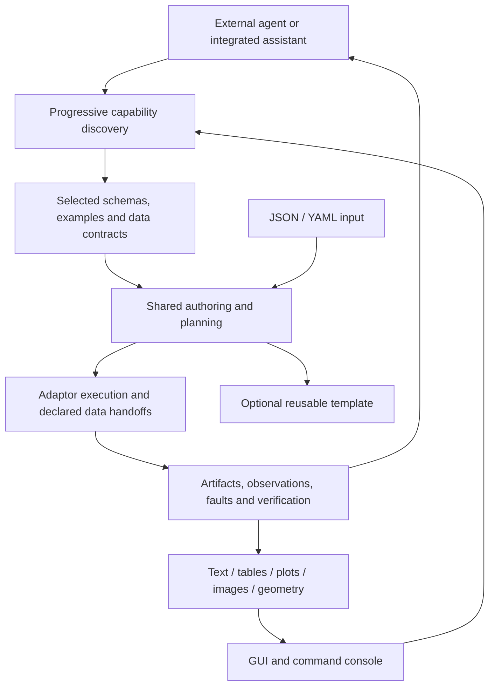

# Schemaxis capability and authoring workspace

Design proposal · 2026-09-27 · implementation status is recorded separately below.

## Product direction

Schemaxis has two equal product purposes:

1. **An application capability environment for AI.** An agent learns a common
   interaction protocol, discovers only the capabilities relevant to its task,
   obtains their precise contracts, submits declared work, examines evidence and
   refines its request. A reusable template is an optional outcome, not a condition
   for useful work. The agent can operate without opening a GUI.
2. **Reusable workflow authoring and execution for people.** Authors define
   operations, meaningful parameters, relationships and checks. The resulting
   input can be adapted to many cases and used through a GUI, CLI or agent.

Both share discovery, typed declarations, documents, resource inspection, planning,
execution and verification. The GUI is a human client of that same capability
environment, including a place to provide precise context to an agent. It is not
restricted to template forms or CAD manipulation. JSON/YAML serialise authored
intent; schemas describe its legal structure; capability metadata explains its
meaning, prerequisites and available evidence. Schema alone is not a discovery or
feedback protocol.

An agent learns the common workflow and receives domain-specific contracts as
needed. This reduces integration-specific learning; it does not remove the need
for task reasoning or domain understanding. New adaptors become discoverable
through the protocol without retraining being a deployment prerequisite. Actual
reliability and context efficiency must be measured with unfamiliar task cases.

The design must be exercised with two contrasting inspection experiences: the
FreeCAD elbow and text/log extraction into typed tables and plots. The existing
prototype demonstrates only the first. The author's forthcoming extraction tools
must be examined before defining their execution semantics. Circuit design remains
a future adaptor direction, not a currently supported capability.



## Progressive capability discovery

### Adaptors, categories and curated interfaces

An **adaptor** owns integration with an application or execution backend. A
**capability group** is a navigational category: for example ParaView sampling or
geometry operations. A **curated interface** exposes a deliberately bounded task
contract with useful defaults and examples. A single curated operation can be a
leaf. These groups/interfaces are also called sub-adaptors; they do not
automatically require another process, package or duplicated implementation.

Categories and task-oriented entries can point to the same operation. Use stable
canonical operation IDs and navigable parent/related links, not one exclusive
classification tree. Human labels and aliases may change without breaking stored
documents. Group membership must not change the meaning of an operation's schema.
If a curated interface changes allowed options, defaults or behaviour, give it an
explicit contract identity and map it to its underlying implementation.

Discovery should support both breadcrumb navigation and direct search. An agent
that already knows a capability can address it directly. A new agent can browse
from task categories, from an application, or from the type of data it has.

### A small initial response, precise detail on demand

| Level | Returned information | Deliberately deferred |
| --- | --- | --- |
| Root | Protocol/catalogue version, domains, adaptor summaries, navigation links | All operation schemas |
| Group | Purpose, children, concise input/output kinds, limitations | Full property catalogues |
| Operation summary | Stable ID, purpose, prerequisites, status and related capabilities | Unrequested examples and nested options |
| Operation detail | Selected authored schema, semantic constraints, units, defaults, examples, expected output/evidence | Unrelated operations |
| Resource-specific detail | Observed fields, dimensions, bounds, compatible operations, sample results | Whole datasets in agent context |

Responses carry a catalogue revision, stable IDs, parent/next links, and explicit
pagination/truncation. Support bounded response size and targeted detail sections;
never silently omit a required argument or constraint. A complete executable
contract must be obtainable even when delivered in referenced chunks. Cache by
contract/catalogue digest so an agent can avoid repeatedly receiving unchanged
metadata. Preserve the distinction between contract version, native runtime
version and native qualification scope.

Track separate axes: declared/inventoried support; installation availability;
native qualification and its scope; input compatibility (supported/unsupported/
unknown). An inventoried native option is not automatically executable. Static
discovery/planning must not launch or import native applications; resource-specific
inspection is an explicit execution activity when it needs a native runtime.

### Proposed common interaction surface

The following names describe transport-neutral service contracts, not existing
commands or endpoints. Reuse current implementations behind them where possible.

```text
search_capabilities(intent_terms, input_traits?, scope?, limit?, cursor?)
browse_capabilities(scope_id, catalogue_revision?, limit?, cursor?)
describe_capability(capability_id, sections?, known_digest?)
inspect_resource(resource_id, requested_facts, sample_bounds?)
plan(document_revision, input_bindings, constraints)
execute(plan_id, expected_revision, execution_budget)
observe(job_id, requested_evidence, cursor?)
verify(job_id, expectations)
cancel(job_id)
```

Keep search usable through curated keywords/facets initially. Semantic search can
be an optional ranking layer; it must return authoritative capability IDs rather
than inventing an executable operation. Preserve the existing CLI as a first
client. A small agent-facing tool transport and the web service use the same core;
do not publish hundreds of unrelated application-specific agent tools at startup.

## Agent execution and feedback loop

The agent owns interpretation of the user's goal and its success criteria.
Schemaxis owns declared operation semantics, validation, execution, data movement
and evidence. An iteration is:

1. Discover candidate capabilities and their requirements.
2. Inspect bounded input metadata or samples where needed.
3. Compose a declared request or revise the current document.
4. Plan dependencies, resource use, publications and permitted conversions.
5. Execute within the task's authorised scope and explicit budget.
6. Inspect selected results and verification evidence; compare with the goal.
7. Refine, finish, or report an unmet requirement with a useful next step.

The same objective can be achieved in one run or through several iterations. Store
the actual requests and outcomes; promoting a successful run into a parameterised
template is optional. Human reference chips can accompany the objective or later
feedback, including when an external agent is the main driver.

Use explicit limits for attempts, elapsed time, output volume and native resource
use. Detect repeated unchanged failures; do not retry indefinitely or hide partial
results. A run's success and the user's objective being satisfied are separate
claims. Numerical checks, rendered evidence and a human judgement each have a
stated scope. Existing user authorisation can cover a bounded iterative task;
do not insert a mandatory approval stop before every operation.

## Managed data and handoffs

The agent addresses resources and artifacts, requests transformations and reads
bounded observations. Schemaxis performs the supported reads, extraction,
conversions and application handoffs. Large logs, meshes and tables remain in the
execution/resource layer; agents receive metadata, selected samples, diagnostics
and references to complete artifacts.

Resource descriptors need identity, content revision/digest, type/shape, units,
field names, provenance and relevant external dependencies. Describe unknown
traits as unknown. Native process-local handles never become portable resource
identities. Reuse current artifacts/receipts and extend their contracts as needed.

Conversion automation requires declared producer/consumer compatibility and
qualified conversion operations. Prefer a direct compatible handoff; an allowed
conversion must be visible in the plan, with losses, unit changes and cost limits
declared. An agent should not write ad hoc conversion scripts to bridge a missing
contract. Missing support produces an actionable capability gap. Automatic
conversion planning is a future increment, not an existing universal service.

The intended promise is that the agent need not perform supported data plumbing
itself. It is not a promise of arbitrary, lossless conversion between any apps.

## Screen structure

- **Navigator:** capability breadcrumbs/search, documents, operations, resources
  and named references. Application selection is one entry point, not mandatory.
  Adaptor discovery is searchable by functionality and application. Discovery
  distinguishes registered support, installed runtime and verified readiness.
- **Document surface:** Source, Inspect and Split modes. JSON and YAML are two
  serialisations of the same document. A source location and its corresponding
  property control should be mutually navigable. Preview is explicit.
- **Inspector:** contextual properties, compatible input choices, units, examples
  and documentation. Parameter references remain references when editing values.
- **Agent collaboration:** an integrated assistant panel or an external-agent
  session. Context, discovery trail, proposals, execution and evidence are visible.
  An external agent can use the engine with no browser or integrated AI provider.
- **Command drawer:** explicit commands for the same active document. Help and
  completions derive from declarations plus current document context.
- **Status:** draft errors, preview provenance, unsaved state and runtime readiness
  are different states. Never condense them into a generic green “valid” badge.

The main desktop layout uses a narrow navigator, flexible document surface and
properties/assistant sidebar. At smaller widths the inspector moves below the
document; inspection and source remain usable in individual modes. The original
prototype's Model tab is one instance of the more general Inspect surface.

### Task-oriented workspaces

Provide named workspace presets that assemble reusable editors/viewers, contextual
tools and linked selections for a kind of work. A workspace is not an adaptor:
several adaptors may participate in one workspace, and one adaptor may participate
in several workspaces. Source, resource inspection, history and agent collaboration
remain shared across them. Selecting a workspace changes the working arrangement,
not the meaning of the document or its execution state.

The proposed [workspace catalogue and extension contract](workspaces.md) includes
CAD/geometry, text extraction, tables and signals, workflow graphs, class/UML
views and concept/mind maps. Implementation is staged; a workspace preset does not
claim an executable adaptor exists for every subject shown in it.

Distinguish a workspace preset from its panels and their capabilities. Text editors,
tables, plots, diagrams and native geometry viewers can be reused in many presets.
Each panel declares what it reads, what it can edit, which references it creates,
and which declared service operations implement its actions. Diagrams need explicit
semantics: executable workflow, structural model and brainstorming map are different
document kinds even if they share a graph-rendering component.

## Inspection surfaces and typed references

Choose the inspection surface from the resource/operation contract, not a hardcoded
application-name branch. An adaptor may support several views. Registered trusted
view implementations consume versioned observation data; authored input does not
supply arbitrary UI code. Provide an explicit unsupported-view fallback.

| Surface | Useful interaction | Reference kind |
| --- | --- | --- |
| Text/log | Select a line, range, match or capture group | Snapshot + line/byte span + encoding |
| Table | Select a row, column or cell; inspect missing values | Table artifact revision + row/column identity |
| 1D plot | Select an interval or sample | Series identity + sample/domain interval + units |
| 2D plot/image | Select pixels, a region or mapped coordinates | Artifact revision + declared coordinate space |
| Geometry | Pick a face, edge, vertex or mesh element | Native object/subelement + source revision |

A reference chip is a typed pointer to evidence, with a readable label. It is not
limited to a geometric point or prose composer. The command editor, operation
forms, agent context and saved requests should consume compatible reference kinds.
Historical observation references remain inspectable; reusable authored selectors
have their own replay/validation contract. Do not confuse a file's line 120 in one
snapshot with “the residual measurement” in every future file.

### Text extraction workbench

The log-extraction experience has three coordinated areas: source text with line
numbers and highlighted matches, ordered extraction stages, and resulting typed
rows/columns with an optional plot. Selecting a result returns to the contributing
source span(s); selecting a capture shows its conversion and destination column.
The JSON/YAML source remains available beside these views.

The author's repeated-grep implementation is the starting point for the engine
contract. Determine whether stages filter preceding output, search the original
file, establish record boundaries, or associate captures across lines. Do not
replace those semantics with an assumed single regular expression.

Declare the pattern dialect and flags, stage order, match multiplicity, capture
names, numeric conversion, units, record alignment, missing/duplicate behaviour
and text encoding. Retain source provenance through every stage. No-match, missing
capture and failed numeric conversion are distinct outcomes; do not silently turn
them into zero or shift values into a neighbouring record. A regex declaration is
data, not a shell command. Bounded execution must also handle expensive patterns.

Interactive previews label the inspected byte/line range and sample coverage.
Show match counts and rejected records, and offer a separate full-input run. A
successful sample is not proof for the complete file or another case. Appending,
rotating or replacing a log creates a resource revision; retain the referenced
snapshot/range or report stale evidence. Avoid loading the whole log into browser
or agent context.

An illustrative task is extracting iteration and residual measurements into a
table. The human highlights an example block or the agent requests a bounded sample,
then proposes extraction stages. Schemaxis shows matched text and typed results.
After correcting alignment or conversion faults, run on a second file and expose
case-specific inputs as parameters if a reusable template is wanted. Exposing the
result to Octave or Calc must follow their actual numeric contracts; do not promise
that every multi-column extraction fits their current bounded interfaces.

## State and editing contract

### A draft is allowed to be incomplete

Retain both source text and the last accepted authored document:

| State | Meaning | Available actions |
| --- | --- | --- |
| Draft text changed | Parsing has not completed for this exact draft | Edit, preserve draft, undo |
| Parse error | No usable data model for this draft | Diagnostics, edit, preserve draft, undo |
| Structural/semantic errors | Parsed document with located errors | Edit, inspect diagnostics, preserve draft |
| Planned | Existing host planner accepted this exact revision | Execute with an available runtime |
| Native operation running | A job owns a captured document revision | Inspect progress, request cancellation |
| Verified result | Native checks passed with a stated scope | Inspect artifacts, save matching native output |

An earlier preview can remain visible with an explicit earlier-revision label.
Picking and execution must never silently use that earlier revision. Persisting
an invalid draft is distinct from exporting a validated executable input.

Text editing commits should form sensible undo groups, not one revision for every
keystroke. Preserve cursor/selection, comments and formatting where possible.
Forms must not replace a half-written source buffer. Flush or explicitly resolve
the draft before a command or another editor applies a change.

### Shared edit service

Introduce a shared authoring service around the existing session, rather than
implementing separate document semantics in each client. Proposed operations:

```text
read_document(document_id)
update_draft(document_id, expected_draft_revision, format, source_text)
check_draft(document_id, expected_draft_revision)
propose_edit(document_id, base_revision, edits, provenance)
apply_edit(proposal_id, expected_revision)
plan(document_id, expected_revision)
execute(document_id, planned_revision, execution_options)
export(document_id, revision, format, destination)
```

These are design contracts, not currently available HTTP endpoints. Use explicit
revision checks to prevent stale form, AI or multi-tab edits. An edit records its
origin (source/form/command/selection/AI), a useful summary and one undoable change.
Reuse the existing job scheduler, workspace ownership, receipts and cancellation.
Adapt existing console commands into this service incrementally.

Preview/execution should capture a specific accepted document revision. The first
implementation can retain the console's serial-operation policy; later concurrent
draft editing must label results by their captured revision and never replace a
newer document's state with an older job's result.

### Linked files and recovery

Each document has an optional source file, source format, saved content digest,
draft revision and accepted model revision. Save and Save As have explicit targets.
Use atomic replacement for authorised saves; do not overwrite an external edit
whose digest differs from the last observed file. Present reload, compare or Save
As choices on conflict. Retain recoverable drafts in the workspace, including
invalid text; browser storage alone cannot be the authoritative recovery store.

## Schema-backed assistance

Use the current registry, operation declarations and authored schema exporter.
One document has one explicit document version. A project may contain several
documents and adaptors; supported cross-application jobs use the workflow envelope.
An umbrella schema is a union of valid document formats, not a merger of all keys.

Add presentation metadata alongside declarations: readable labels, units,
categories, examples, documentation anchors and basic/advanced grouping. Keep
validation in the existing schemas/planners. Generated GUI controls must not
become another hand-maintained list of legal options.

Context-sensitive suggestions need more than a schema: preceding compatible
feature IDs, known dataset fields, named selections, resource paths, units and
provider capabilities. Runtime-derived choices are provenance-bound to the
inspected data or preview. Distinguish unavailable inspection from an empty list.

External editor support remains first-class: export an authored schema and
provide editor association instructions. A future language service can reuse
the same document checks and completion context as the web UI.

## JSON and YAML

Both readers produce the same finite JSON-compatible data model, then enter the
same schema, composition and planning pipeline. Keep internal receipts and native
worker protocols in their existing canonical format. Do not duplicate schemas.

Define YAML parsing rules: one document per input, string mapping keys, duplicate
key rejection, no arbitrary object construction, bounded aliases/expansion and
consistent finite scalar types. Preserve source ranges for diagnostics. A shared
loader needs explicit format selection for stdin as well as suffix-based file
selection. Console `open`, CLI inputs and export must use the same contract.

The current repository requires a dependency-free Python host. Before implementing
YAML, deliberately decide how to provide a maintained parser and whether to amend
that rule or isolate YAML tooling in an optional authoring package. Avoid a bespoke
partial parser pretending to support YAML fully.

Semantic parity and editing fidelity are separate requirements. Comments, anchors
and formatting require a source-preserving representation; a generic parse/dump
cycle is not enough for in-place GUI editing of hand-authored files.

## Visual selections and modelling

Existing reference chips are evidence of a pick at a document revision. Introduce
an authored selection contract for reusable modelling inputs. Keep the historical
pick as provenance; do not substitute session-local `refA` into portable files.

An authored selection needs a stable user name, source feature, native element
kind, selection rule, source dependency identity and validation evidence. Runtime
resolution produces a native element or an explicit missing/ambiguous/stale fault.
The representation must be serialisable and replayable from the saved document.

Downstream operations depend on the selected upstream feature. Adding a downstream
extrusion should not invalidate its own source selection. Changes to that source
must revalidate the selection. Never assume `Face3` survives topology changes or
silently choose the nearest face after a failed match.

Provider-specific selection kinds remain explicit: CAD faces, mesh elements,
image pixels/regions, table rows/columns, and signal intervals are not equivalent.
Commands advertise which kinds they consume. A PNG pixel cannot feed CAD extrusion.

For the first elbow increment, reuse the existing circular profiles and explicit
extrude/cut/fuse graph. General face extrusion is a separate FreeCAD capability:
it must preserve inner wires, declare direction and join behaviour, and receive
native verification before being advertised. The illustrative prototype only
implements the original-profile inlet path.

## AI clients and embedded assistance

Agent-driven operation is a primary interface to Schemaxis. Define an optional
embedded assistance-provider boundary independent of application adaptors.
Possible transports include a supported agent integration and a model-provider
API. Choose and qualify one integration first. A consumer subscription, developer
API credential and installed coding agent must not be treated as interchangeable.
Provider-specific authentication and subscription eligibility remain to be checked.

Expose the progressive capability and execution protocol to external agents as
well as the embedded assistant. Provide bounded tools for discovery, reading the relevant document,
retrieving diagnostics and selected preview evidence, proposing document edits,
planning and observing explicitly requested executions. AI edits go through the
same edit service and optimistic revision checks as forms and commands.

The user can see what context is included, the proposed diff and validation results.
Applying a suggestion creates one undoable document revision. Delegated execution
follows the user's task scope; an interactive review can pause at a proposal, while
an authorised agent task can execute a bounded sequence without per-step approval.
Keep provider credentials out of authored documents, exports and ordinary logs.
Do not expose arbitrary Python execution through document input.

## Setup and application management

Setup can begin from functionality or a named application. Catalogue entries need
maintained capabilities, platform/version support, licence/trial information,
official distribution provenance and installation methods. Unknown licence or
installation state must appear as unknown, not “free” or “installed”. Do not infer
supported Schemaxis functionality from an upstream application's full feature set.

First detect or configure existing applications. Offer managed downloads only
where installation and redistribution terms have been checked. Retain the user's
download preference and planned selections; do not silently install all adaptors.
Keep managed applications, caches, credentials, project resources and generated
results in separate locations. Existing installations remain usable in place.

Authoring, discovery and planning do not require native applications or AI.
Application changes remain explicit lifecycle operations; the current registry
does not support live package installation in a running session.

## Implementation increments and acceptance

The detailed [delivery plan](delivery-plan.md) now replaces the earlier CAD-first
sequence. The next implementation target is progressive discovery and a small
agent-facing capability service, using existing adaptors. Shared authoring and
typed inspection follow with both geometry and text/table acceptance cases.

The extraction implementation depends on the author's forthcoming tools and examples;
discovery, shared contracts and existing-adaptor agent trials can proceed now.
YAML's dependency policy must be settled before promising full YAML support, but
it does not block the JSON-based discovery/execute/observe loop. Template promotion
and richer installer/AI-provider choices build on the same shared services.

## This prototype: implemented and simulated

The existing screen prototype predates the two-purpose scope above. Its CAD
surface, scripted assistant and setup wizard remain useful interaction studies;
they do not demonstrate the agent discovery loop or text extraction workbench.

Open `index.html` directly or serve this directory with a loopback HTTP server.
There is no build step, third-party frontend dependency or external asset request.

| Interaction | Prototype behaviour |
| --- | --- |
| Dimension/property edits | Change a real in-tab JSON document; preserve existing `$document` expressions |
| Feature inputs | Filter choices using earlier feature kinds from declarations |
| Source editing | Editable JSON with a small local draft-check subset; no full schema validator |
| Invalid source | Retained; disables export/preview and property edits; Undo recovers usable text |
| YAML | Read-only serialisation/export preview; no YAML parser or round-trip editing |
| Undo | In-memory document history; reload resets the prototype |
| Export | Downloads JSON/YAML from the current in-tab authored document |
| Geometry | Procedural canvas illustration of elbow dimensions and the example inlet extension; never native evidence |
| Named selection | One illustrative inlet/outlet selection held separately from the exported input; general portable selection contract is not implemented |
| Inlet extension | Adds four existing extrude/cut/fuse nodes; no native execution |
| Operation catalogue | Real declaration fixture, option defaults and simple compatible-input snippet insertion |
| Adaptor catalogue | Real registry metadata; FreeCAD is the only editable document example |
| Assistant | Fixed example proposal, revision check and real draft application; no AI request |
| Setup | Navigable preference mockup; no saved settings, installation, credential capture or downloads |

`catalogue.js` is a design fixture generated from the adaptor registry, FreeCAD
declarations and `examples/demos/pipe.input.json`. It must not become a second
production registry. The deployed app should obtain this metadata from the shared
service. The prototype's local checks, YAML serializer and canvas are design aids,
not proposed replacements for production parsing, planning or native geometry.
