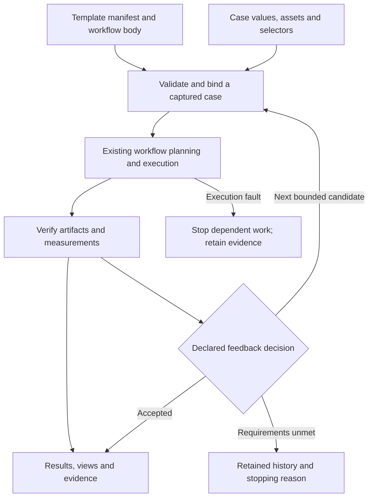

# Workflow template architecture

Status: architectural direction approved, 2026-10-03. This document includes
future features; the [implementation status](implementation-status.md) and
[template contract](template-contract.md) identify the supported first subset.
The [numerical extension](numerical-coupling.md) distinguishes live coupling from
the bounded whole-candidate feedback described here. This design
extends the [authoring workspace](../authoring-workspace/architecture.md).

## 1. Preserve three different things

| Object | Meaning | Owner |
| --- | --- | --- |
| Template | Reusable procedure, allowed parameters, selectors and presentation hints | Author |
| Case | Values, user assets and selection choices for one use of the template | User |
| Run | Captured inputs, effective documents, attempts, logs and verified results | Execution service |

Editing a template or case creates a new revision. It never rewrites the meaning
of a completed run. Files, forms, diagrams, CLI and agents all use the existing
revision-checked authoring service. Panel layout and camera navigation remain
presentation state until explicitly captured as authored values.



## 2. Files and proposed format

A directory is the initial distribution unit. Archive import/export is later and
must preserve the same manifest, hashes and relative paths.

```text
spoiler-study/
  template.json           # schemaxis.workflow-template/1, proposed
  workflow.json           # schemaxis.workflow/1, already implemented
  cases/road-car.json      # schemaxis.workflow-values/1, proposed
  assets/                 # optional redistributable fixtures
  README.md               # purpose, assumptions and qualified example
```

The template contains `version`, `id`, `revision`, `title`, `workflow`, `parameters`,
`outputs` and optional `selectors`, `requirements`, `study`, `ui` and `assets`.
`workflow` is a relative file reference inside the bundle; loaded dependencies are
captured before planning. Initially it names one complete workflow file. Splitting
every operation into its own file is deferred until conflict/revision semantics
are defined. Unknown fields and protocol versions produce located faults.

`requirements` records explicit application/operation requirements and qualification
scope. The compiler also derives actual requirements from the workflow registry
and checks agreement: the list is not another editable adaptor registry. An
installed adaptor, an available runtime and a qualified operation are different
states. Templates and UI metadata cannot import plugins, load scripts or launch
native applications during discovery.

The ordinary workflow body remains authoritative about execution. It contains
ordered operation instances with distinct IDs and ordinary adaptor documents.
The adaptor is resolved from each document's version, avoiding a conflicting
second `app` field. A step may itself contain a native node graph.

```text
design-geometry [FreeCAD]
    → generate-mesh [Gmsh]
    → calculate-adjustment [Octave]
    → revise-geometry [FreeCAD]
```

This is a directed sequence of four distinct operations. Their artifact/value
references establish dependencies; repeating FreeCAD does not create a graph
cycle. Current serial workflows use declared order. Current scheduled workflows
can run independent operations concurrently. The creator must label actual
dependencies, not suggest every displayed neighbour has a data edge. The first
template release preserves those rules and does not add forward references,
arbitrary cycles or an undocumented second scheduler. A future order-only
dependency would need an explicit extension, not a fabricated artifact edge.

## 3. Parameters and binding

Each parameter has a stable ID, label, help, kind, constraints, optional default,
optional units, and one declared binding target. Initial kinds are boolean,
integer, number, enum, string, vector, resource and selection. A quantity's plain
numeric value uses its declared unit. An alternative unit requires an explicit,
validated conversion; a label such as `mm` is not itself dimensional analysis.

Prefer targets in workflow-wide `dimensions`, `settings` or `definitions`; native
fields then refer to that single value through existing scoped `$document`
references. An operation-local target uses its stable operation ID and an RFC 6901
pointer relative to its document. A node-specific target should use the existing
node ID before its property pointer, not an operation-array index. All locators
must resolve uniquely. Deletion or renaming makes a binding invalid until repaired.

An initial manifest fragment is:

```json
{
  "span": {
    "label": "Spoiler span",
    "kind": "number",
    "units": "mm",
    "constraints": {"minimum": 100, "maximum": 2000},
    "default": 1000,
    "target": {"scope": "workflow", "pointer": "/dimensions/span"}
  }
}
```

This is metadata around existing authored values. It does not introduce string
substitution or executable Python. Constraints are checked by the host and again
by each destination's normal planner. The form may narrow a native contract but
cannot bypass it. Defaults undergo the same validation as supplied values.
Start with an explicitly documented schema subset for parameter metadata; arbitrary
JSON Schema claims would require a compatible validator. Rich editor schemas
continue to come from the existing schema exports and capability catalogue.

Bindings apply atomically to a copy of the captured body. Reject unknown values,
missing required parameters, duplicate/overlapping targets and incompatible types.
No partial publication on failure. Existing expressions remain expressions; a
derived field is read-only in the run form. `Expose as parameter` makes a deliberate
authored change and previews all affected sites before recording one undo group.

The values file carries its own format version, the template ID/revision and a
semantic bundle digest, plus `values` and optional `resources`. The semantic digest
covers the manifest, workflow, included declarations and declared assets; exclude
case values, run directories and transient UI layout. Define canonical encoding
with existing digest utilities. An exact mismatch requires an explicit migration
with a diff; never silently bind against the latest template revision.

Load sequence: strict JSON → bundle/version checks → parameter validation → asset
capture → selection resolution where data is available → atomic binding → existing
planning. Result-dependent selection/values remain explicit deferred requirements.
Run-time native validation still occurs after verified producers finish. Capture
the effective workflow and a source map from native faults back to parameters.

## 4. Sweeps, feedback and physical time

These three concepts must have different UI labels and records:

| Mode | What drives the next state | Existing foundation |
| --- | --- | --- |
| Once | One supplied case | Workflow executor |
| Sweep | A finite authored sequence or Cartesian/synchronised axes | `InputProgram`, analytics, workflow study |
| Feedback | Verified results from the previous complete candidate | Shared feedback controller; new workflow policy adapter needed |
| Native physical time | A solver's time evolution or a dataset's stored times | Individual adaptor contracts |

Changing spoiler length and rerunning steady CFD is a design study. It does not
implement a moving mesh or an unsteady simulation of a changing spoiler. A
time-varying physical model needs explicit solver support beyond this design.

A proposed template `study` selects `once`, `sweep` or `feedback`. A sweep compiles
through the existing finite study mechanism; do not create another independent
axis loop. The first release rejects simultaneous case-level sweeps and already
embedded workflow axes unless their synchronisation has been explicitly specified.
Later nesting must retain a calculable total state/resource bound.

Feedback wraps the whole workflow as one candidate. Reuse `feedback.run` and its
verification replay through a new installed, trusted workflow-policy adapter.
Keep `schemaxis.feedback/1` as a receipt protocol; do not reinterpret it as the
new authored file format. The candidate callback instantiates the template and
executes/verifies the complete workflow before publishing named measurements.

The policy contract declares controlled parameter IDs, initial values, admissible
bounds, a deterministic update, measurement mappings with units, an acceptance
rule and finite budgets. First support one scalar update/target policy using the
existing closed expression/value-function machinery. A user equation may refer
only to declared controls and verified observations, with explicit unit handling.
Do not evaluate arbitrary code or accept a free-text optimisation objective.

Candidate zero uses case values. Subsequent candidates use only the immediately
previous committed history plus any explicitly declared retained state. Rebuild
each candidate from the original captured case and immutable user model by default;
do not repeatedly deform the last model. Carrying geometry forward is a separate
declared artifact state, requiring a supported import contract. Record both proposed
and applied values. Optional damping/clamping must be visible policy settings,
not a silent alteration of an engineering equation.

Use the existing 1–20 candidate limit initially, with a mandatory total deadline
and per-operation budgets bounded by the remaining total. Inner adaptor studies
consume those same enclosing budgets. Stop on nonfinite updates, invalid units,
missing measurements, stalled updates, oscillation when detected by the declared
policy, exhausted bounds, cancellation or limits. A proposed convergence criterion
must state tolerance, minimum evaluations and any consecutive accepted count.
Converging a design parameter does not prove the CFD solution has converged.

Each candidate gets a fresh directory, retained effective input, asset digests,
selector resolutions, verified measurements and decision. Preserve rejected
candidates. Only accepted candidates supply success outputs; an unmet target
remains a separately reported outcome. Native/verification failures stop dependent
work; they are not ordinary rejected optimisation candidates. The benchmark's
continue-after-timeout policy is not inherited by product feedback studies.

First delivery does not resume a partial feedback history. It can inspect the
history and restart into a new run, matching the current controller. Existing
unchanged successful workflow reuse remains available after verification. Partial
resume would need its own checkpoint and replay acceptance tests.

## 5. Selections become authored inputs

A chip is evidence of a pick on a particular revision. It currently has
`replayable: false`, and must retain that meaning. Add an explicit **Use selection**
action with three choices:

| Choice | What the template/case stores | Behaviour on new data |
| --- | --- | --- |
| Fixed to this asset | Asset digest, provider identity and native element IDs with source provenance | Exact-asset match required; otherwise reselect |
| Reusable rule | Typed selector, declared coordinate frame/units and match constraints | Resolve and verify again for every input state |
| Ask when running | A typed selection parameter plus constraints and optional suggested rule | User supplies a pick or rule for that case |

Selectors are separate authored objects, not edited historical chips. Common
envelopes identify subject resource/stage output, expected entity kind, resolver
contract/version, rule and cardinality; native predicate semantics belong to the
adaptor. A resolution receipt records source revision/digest, matched identities,
geometry/label evidence, counts, tolerance and native assignment readback.
Cached results are invalidated by any input, selector, frame or topology change.

For anti-soiling patches, support exact names first, then a bounded name-pattern
selector such as `^antiSoil_[A-Za-z0-9_]+$`, with `minimum: 1, maximum: 2` and
entity kind `boundaryPatch`. Explicitly define full-name matching, case sensitivity
and ordering. Use a bounded regular-expression subset without backreferences or
look-around, evaluated in a cancellable worker with name/count/length limits.
Invalid, timed-out, empty and too-many matches are different faults. Never use
the first match as a fallback. Display every matched patch before binding.

Patch names come from the mesh/case inventory, not a browser's triangle labels.
FreeCAD semantic edge predicates already provide one bounded resolver; they do
not yet provide general face/patch naming. CAD face → exported surface → mesh patch
needs a checked mapping artifact with units, transforms, source IDs, target names
and declared topology losses. Without it, require selection on the consumer's
own inventory. Equal match counts alone do not establish preserved identity.

Spatial controls are typed too: plane(origin, normal, frame), line endpoints,
seed points, boxes and surface regions. A draggable slice plane or stream-tracer
seed edits these declared values. Never infer an executable selector from the
screen position alone. Coordinate frames identify model/world/case space and the
captured transform; provider geometry predicates retain their own tolerances.

For 2D views, first add rectangle and polygon regions, followed by masks and native
object/layer selections where supported. Specify image digest, dimensions, origin,
pixel-centre/edge conventions and fill rule. Regions use top-left pixel-edge
coordinates in `[0,width] × [0,height]`; rectangles are half-open and polygon fills
use pixel centres and an explicit even-odd rule. Reuse on a different image needs
an explicit normalised-coordinate, named-object or registration transform contract.
A photo region is not a CFD boundary patch. A 3D viewport lasso additionally needs
visible-only versus through-selection semantics before it becomes an authored rule.

For tables, support column names, typed predicates and explicit row identities;
retain positional ranges only as snapshot selections. Sorting changes display
order, not the identity or provenance of a selected result row.

## 6. Resources, paths and native working directories

Use logical resource IDs in cases and typed named ports in the creator. A compiled
mapping connects named ports to the current artifact-index/value-pointer contracts
and pins their declaration digest; verify the selected receipt's kind and metadata.
Initially this is an alias layer over existing receipts, not a silent change in
artifact ordering. Do not guess a producer index from a filename extension.

Resource descriptors distinguish a file, file set, directory dataset, native project,
image, geometry, table and scalar measurement. Include format, constituent files,
units/frame/time/array association when applicable, hash/provenance and completeness.
Readers declare accepted kinds and losses. References to files inside `.pvsm`, CAD
projects or case directories must be captured transitively by the owning adaptor;
one top-level file hash is not a portable bundle guarantee.

The run owns a structure such as:

```text
run-id/
  captured/                 # template, case and asset manifests
  iterations/0000/
    operations/design/attempt-0000/{inputs,work,outputs,logs}
    operations/mesh/attempt-0000/{inputs,work,outputs,logs}
  results/                  # verified published selections, not scratch files
```

Exact paths are an implementation detail returned by the service. An installed
adaptor declares its working-directory and output rules. The launcher can set a
private `cwd`, pass explicit output paths, or collect files from an app-controlled
location using a declared mapping. Template authors cannot supply shell commands.
An adaptor needing a shared fixed location must acquire an exclusive lease or
report unsupported concurrent execution. It must not change the host's global cwd.

Capture user inputs by copy or verified read-only reference; never modify the
original model/case implicitly. Mutable solver work uses an owned copy or explicit
lease. Directory manifests cover expected structure and constituent hashes,
including processor/time subdirectories when relevant. Validate resource capture
against concurrent writers; incomplete live data remain preview-only until a
defined checkpoint is published. Resuming or exporting rechecks the manifest.

Collect outputs only after the native stage closes or exposes a documented stable
checkpoint. Copy into staging, verify, then publish atomically where supported.
Moving between filesystems requires copy/verify followed by owned-source cleanup;
do not claim an atomic cross-filesystem rename. Keep user assets and unrelated app
files outside cleanup. Resolve relative case paths against the values file and
bundle paths against the template root. Reject path traversal, escaped symlinks
and undeclared external dependencies. Runtime executable paths stay in private
configuration; they do not belong in portable template values.

## 7. Creator and views

Use the existing local browser console and transport-neutral execution service.
The first creator has three modes over one model: **Author template**, **Run a
case**, **Inspect results**. Editing and running are explicit actions. Selecting
a display preset does not change the procedure or start a native job.

Author flow:

1. Search capabilities by keywords, application, input/output kind or domain.
2. Add a uniquely named operation from a declared adaptor document/example.
3. Connect supported outputs to inputs; display units, conversion and readiness.
4. Edit source with schema completion, syntax highlighting and located diagnostics.
5. Select an existing value or viewport control and choose **Expose as parameter**.
6. Choose a fixed selection, reusable rule or run-time selection input.
7. Test the template on a second case, inspect resolved selections and outputs,
   then save its qualified scope and expected result checks.

Source, property controls, diagram and parameter form share authoring revisions,
source maps and undo groups. Parameter edits preserve expressions. Invalid drafts
remain recoverable and cannot execute an older valid document as the current one.
The existing schema exports are the language authority; editor completion is a
convenience and the host planner remains authoritative. Frontend editor dependencies
must be locally packaged; keep the Python host dependency-free.

Views declare supported resource kinds, observation limits, selection kinds,
editable control types and update mode. Capabilities may be absent; unsupported
controls are not rendered as apparently working buttons. Existing geometry, image,
text and table panels are reused. Promote typed selections through one shared
service callable by GUI, CLI and agents. No provider-name branches in the shared
framework: native control/readback belongs to registered adaptor hooks.

Separate three levels of interaction:

- **Author/overlay:** move a plane, seed or camera over already loaded geometry;
  save declarative controls without executing the candidate operation.
- **Preview:** explicitly load/execute a bounded native subset in a managed session;
  label data revision, cost/budget, sample coverage and verification scope.
- **Run:** execute the captured workflow and verify its required publications.

Obtaining initial geometry can itself require native work; never label a fresh
file load or actual computed slice as a pure host plan. A plane outline can move
without rerunning a slice; computed slice/streamline output requires native
processing. Debounce preview requests, cancel superseded work, reject late replies
from old revisions and retain one undo group for a drag gesture. Save camera
navigation only through an explicit capture action.

ParaView integration should begin with the existing managed worker and declared
slice/seed/camera controls. Current support is a serial managed worker with bounded
tessellation and a fixed preview image, not an attachment to any existing desktop
session. A later ParaView view provider can evaluate an isolated trame renderer;
official ParaView documentation demonstrates browser rendering through trame.
This requires a separate optional runtime and qualification, not an added host
dependency. [ParaView trame tutorial](https://docs.paraview.org/en/v5.13.1/Tutorials/ClassroomTutorials/targetedTrame.html).

Desktop Python scripting/tracing is useful for discovery and explicit capture, but
a trace is not automatically a supported declarative operation or complete reverse
synchronisation. [ParaView scripting documentation](https://docs.paraview.org/en/latest/UsersGuide/introduction.html#scripting-in-paraview).

Embedding a foreign application window is an optional platform-specific experiment.
Qt documents platform-dependent support and restrictions on observing or manipulating
foreign windows. It cannot serve as the universal state/selection API. Prefer a
view provider or companion window with an explicit session owner and data protocol.
[Qt foreign-window contract](https://doc.qt.io/qt-6/qwindow.html#fromWinId).

## 8. The car example and its actual admission gaps

| Desired step | Design treatment | Current implementation boundary |
| --- | --- | --- |
| Change spoiler dimensions | Named controls on an editable CAD construction; immutable source plus candidate values | Existing primitive/feature controls and measurements; arbitrary imported geometry does not recover design dimensions |
| Insert a supplied car/model | Resource parameter plus frame, units, placement and compatibility checks | Qualified single-solid STEP/declared Blender routes have narrower limits than arbitrary car assemblies |
| Build a wind tunnel | Named bounds and upstream/downstream factors or fixed dimensions, explicit wind axis/frame | Compose existing supported geometry where possible; solver-ready region construction needs its own acceptance |
| Set physics and unusual wall patches | Domain parameters plus a typed patch selector and verified assignment | Requires a case-preparation provider; physics/BC assignment and native qualification remain unfinished |
| Mesh and solve | Owned case-directory resource, declared launcher/resources, checkpoints and scalar observations | No qualified mesh/solver chain is provided by the current adaptors |
| Place slices/seeds and view output | Overlay controls, optional preview, declared ParaView batch outputs | Managed live worker exists; embedding and broad reverse-sync are new work |
| Feed forces back to spoiler size | Whole-workflow policy with verified force units, parameter bounds and acceptance | Reuse feedback engine; workflow policy and trustworthy CFD observations need implementation/qualification |

Support one or two anti-soiling surfaces by selector cardinality and typed set
binding, not by duplicating the whole template. Treat named patches as a contract
of the prepared case, and verify their mapping after remeshing. A mesh cell/triangle
selected in a display is not automatically the physical boundary in the solver.

## 9. Ownership, compatibility and distribution

Core owns manifest/value validation, binding, source maps, resource identity and
study orchestration. Adaptors own selectors, native controls, directory contracts,
scientific observations, conversion losses and verification. The service owns jobs,
authorisation, concurrency and revisions. Views own rendering and interaction only.

Existing workflow files continue to work without a template. New template commands
are additive; never reinterpret unknown fields in old inputs. No arbitrary Python,
shell or reflection is allowed through a template. New renderer/library dependencies
stay optional and process-local. A desktop shell must call the same service.

First distribution target is a Linux local application using the existing browser
UI, with an installer/launcher that provisions Schemaxis and checks/configures the
required applications. Native apps remain separate installations. Packaged assets,
offline editor dependencies, clean-machine installation, update/rollback and
preservation of user templates/configuration require acceptance. Windows/macOS,
managed native downloads and a Qt shell are later separately qualified targets.

Success is a person creating a reusable template, selecting a different input model,
seeing exactly what will be selected/changed, running it through supported adaptors,
and receiving verified outputs or a precise explanation of an unmet requirement.
