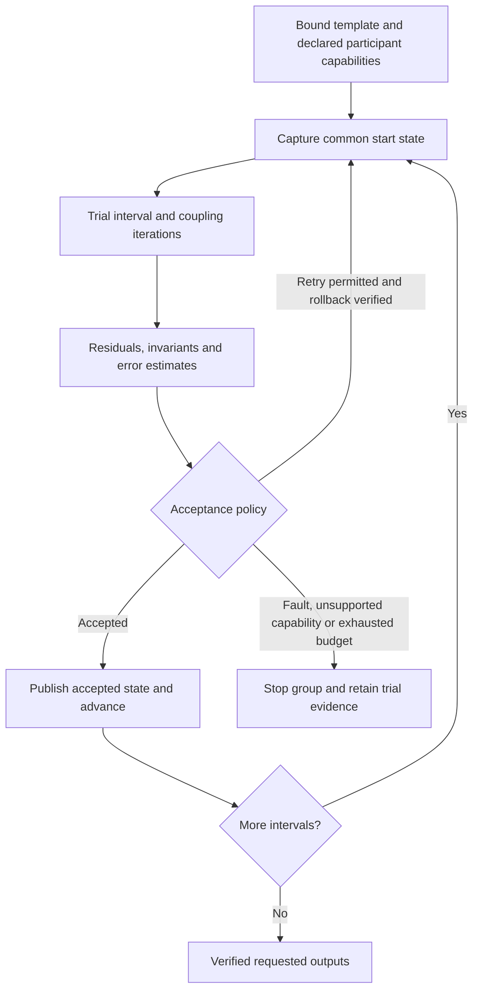

# Numerical coupling: architectural extension

2026-10-03. Design direction following architecture approval and numerical review.
The first development milestone implements template/resource foundations only.
The capabilities and controller protocols below are not yet implemented.

## Reading and scope

Reviewed all of Chapter 2, printed pages 24–61 (PDF pages 53–90), of David
Gaden's 2013 thesis, plus the supplied Appendix C excerpt, printed pages 210–217.
Both extracted text and rendered pages were inspected, including equations and
Figures 2–10 and A1–A3. This note records implications for Schemaxis; it does not
copy the thesis or qualify a native numerical solver.

Source fingerprints:

- `GadenPhDThesis2013-08-07.pdf`, SHA-256
  `6a12336bf135ca9b76e16962669a6ae48f24e005a432b643103bb7c2a3f2f2f7`.
- `GadenThesisExcerptSTSC.pdf`, SHA-256
  `17ed6d34362ab6262609161fd63d543d24a9d77dd737f44214c6314d3d018d3b`.

## What the whole chapter changes

| Thesis material | Consequence for the architecture |
| --- | --- |
| 2.1.1 Root finding | A numerical policy needs an explicit residual, bounds, starting point and failure criterion. Newton's speed does not remove sensitivity to the initial guess. |
| 2.1.2 ODEs | Distinguish a complete application that advances its own solver from an equation provider that evaluates derivatives at requested states. A derivative/Jacobian callback is a stronger capability than reading output values. |
| 2.1.3 Adaptive timestep control | Separate changing the next step from rejecting and repeating the current step. Step doubling requires two comparable trajectories from the same starting state. |
| 2.1.4 Stiffness | Expose scales and tolerances; small oscillations do not establish that the coupled dynamics are accurately resolved. Precision, stability and model validity are distinct. |
| 2.1.5 DAEs | Algebraic consistency needs its own error budget and update schedule. A successful outer integrator cannot certify an independently inaccurate algebraic routine. Equilibrium substitution is a declared modelling approximation. |
| 2.1.6–2.1.7 PDEs/PDAEs | Field exchanges need mesh/location/frame identities. Method-of-lines and native block solvers are possible providers, not a reason to place a PDE solver inside the workflow JSON interpreter. |
| 2.1.8 Coupled/segregated solvers | Scheduling a cycle is insufficient. Declare the feedback law, convergence test, numerical ordering and data from the current versus previous iteration. |
| 2.1.9 Point/curve/STSC | Scalar fixed-point coupling, waveform coupling and source-contribution coupling require different contracts and acceptance tests. |
| 2.2.1–2.2.3 ADM1 variables, kinetics, inhibition | Units alone are insufficient: COD-equivalent mass, actual species mass and molar amount have different meanings. Capture variable basis, admissible ranges and empirical assumptions; do not claim mass conservation from arbitrary scalar sums. |
| 2.2.4–2.2.5 Ions and hydrogen | Algebraic constraints, stiff reactions and fast-equilibrium assumptions belong in the provider's model description. Replacing dynamics with equilibrium changes the model. |
| 2.2.6 Gas model | Transfer rates, volume ratios, pressure conventions and check-valve events are part of the coupling. A bulk quantity is not interchangeable with a local field value. |
| 2.3.1–2.3.4 CFD | Declare constitutive closures, incompressibility/Boussinesq assumptions, pressure reference and transport/source conventions. A pressure port must distinguish total from reduced pressure. |
| 2.4.1–2.4.3 Process control, switching and flow | Events need a schedule and reproducible state. The abandoned timescale-based switching assumption is a useful warning: declare and test scale separation instead of inferring it from application names. |
| 2.4.4–2.4.6 Reactions, algebraic routines, gas transfer | Mixed spatial and bulk frameworks require explicit aggregation/distribution and conservation checks. Repeatedly exchanging arrays does not establish compatible physical meaning. |
| 2.4.7–2.4.8 Energy and turbulence | Document omitted physics and accepted approximations. Temperature transport without reaction heat is a modelling choice, not a general thermal-coupling capability. Turbulence affects transport as well as flow. |

## Keep three levels distinct

1. **Workflow template:** ordered operation instances, parameters, resources and
   selections. A second visit to app A is another operation. Existing verified
   artifact/value handoffs remain the default.
2. **Study controller:** bounded sweeps or design candidates. One full workflow
   produces the observations for the next candidate. Existing `feedback.py`
   provides bounded policy/replay machinery for this level.
3. **Numerical coupling group:** managed participant sessions cooperate over one
   independent-variable interval. Several coupling iterations and rejected trials
   may occur before an interval is accepted. This needs a new controller contract;
   repeatedly advancing existing applications is not an implementation of it.

The ordinary workflow DAG remains acyclic. A future numerical coupling group is
one explicitly controlled composite operation whose internal feedback is visible
in its receipt. Its independent-variable coordinate, coupling iteration, native
substep and design-candidate number must be separate fields. A GUI should display
all four without labelling every repeated calculation a new physical timestep.

## Participant capabilities before controller selection

Capabilities are independent, explicitly declared and qualified per route/runtime.
An application being open or scriptable does not establish any of these promises.

| Capability | Required semantics | Enables |
| --- | --- | --- |
| Evaluate an input/output map | Known initial state or repeatable reset; controlled inputs; observed outputs | Fixed-point/root searches and bounded relaxation |
| Advance over an interval | Independent variable, units, accepted start/end, input hold/interpolation, event reporting | Explicit time/parameter coupling |
| Checkpoint and restore | All relevant internal state, solver history, input state, random state and controlled side effects restored | Repeated coupling trials and step doubling |
| Evaluate a trajectory | Samples, interpolation basis, extrapolation limits and event positions | Curve/waveform stabilisation |
| Evaluate derivatives or residuals | Defined state ordering, units, evaluation state and algebraic consistency | External ODE/DAE integration |
| Supply sensitivities | Identify whether derivative is of an instantaneous RHS, DAE residual, or interval input/output map; define matrix/vector ordering | Newton-type or sensitivity-based methods |
| Inject and recover source contributions | Discrete source action, datum, additive contribution extraction, validity range and readback | STSC for qualified participants |

Full restart from captured input can replace a checkpoint when it reproduces the
same trial-start state and its cost is explicitly budgeted. An output file alone
is not generally such a checkpoint. Participant instances may reuse native
processes, but process-local handles never become portable workflow artifacts.

FMI 3.0.2 makes state restoration, state serialization and derivative provision
separate optional capabilities. This is a useful interface precedent, not a claim
that current Schemaxis adaptors support FMI:
[FMI common capability flags and state operations](https://fmi-standard.org/docs/3.0.2/).

## Black-box coupling and relaxation

For a repeatable coupled map `G`, retain the raw residual `r = G(x) - x` and apply
`x_next = x + omega * r` only according to the selected policy. Assess convergence
using the raw, scaled residual and model constraints, before damping. Testing only
`x_next - x` can mistake an extremely small relaxation factor for convergence.

Specify component-wise absolute/relative tolerances, scale conventions, norms,
invalid-value behaviour, iteration/deadline limits and stagnation/divergence
criteria. Do not silently clamp a physically invalid iterate and mark it solved.
Oscillation may be a coupling defect or real dynamics: analyse repeated solutions
at the same physical interval before deciding to damp the coupling iteration.

Constant relaxation is the first policy to qualify. Adaptive Aitken and
quasi-Newton/Anderson-style methods are later candidates, with bounded history and
degeneracy handling. Established coupling software already exposes these choices;
we should assess reuse before implementing a numerical library:
[preCICE acceleration](https://precice.org/configuration-acceleration.html).

Derivative access is optional, not a universal prerequisite. Finite differences
require repeatable evaluations and appropriate perturbation scales; a black-box
final value cannot generally supply the instantaneous derivatives required by an
ODE integrator. General DAEs require consistent initial conditions and a qualified
solver for their supported class. The thesis's split algebraic-routine strategy
must not be advertised as solving every DAE. See the primary
[SUNDIALS IDA mathematical contract](https://sundials.readthedocs.io/en/latest/ida/Mathematics_link.html).

## Step doubling over an independent variable

Generalising step doubling to another independent variable is sound when the
participant exposes a meaningful step-size-controlled evolution in that variable.
A parameter sweep through unrelated steady solutions is not automatically an
integration method.

For each proposed interval H, restore the common state; calculate one H step;
restore again; calculate two H/2 steps; compare like quantities at the same final
coordinate. For a qualified order-p method in its asymptotic range, the familiar
fine-solution estimate uses the coarse/fine difference divided by `2**p - 1`.
The step controller's exponent depends on the estimator's order; the thesis's
fourth-order example uses a fifth-root scaling. Never hard-code that exponent for
an unknown application. If effective order is unknown, report a discrepancy and
use a separately qualified empirical policy without claiming a certified error.

Coupling errors, inner solver tolerances, interpolation and events affect this
comparison. Compare the complete coupled interval, not merely one participant's
local truncation estimate. Bound minimum/maximum step, growth/shrink factors,
rejections and total evaluations. Detect zero error and non-finite estimates.
Break at discontinuities according to an explicit event policy. After acceptance,
commit the selected trajectory and its state; rejected trials publish no accepted
physical advancement. Repeating native external side effects is prohibited unless
the participant's controlled trial protocol accounts for them.

Without repeatable restoration, only a declared backward-looking controller can
change the next interval. It cannot retroactively reject a completed interval or
claim forward-looking step-doubling error control (thesis 2.1.3, Figure 4).

## STSC: preserve the discrete contribution, not just the port name

Appendix C separates two uses:

- C.2 turns a supplied output history into a source-driven dependent variable in
  another numerical framework. Equations A9–A10 require matching time
  discretization to reproduce the supplied result.
- C.3 makes shared-output participants account for each other's contributions.
  Each solves with the other contributions included, then extracts its own effect
  relative to a common datum; contributions are iterated to stabilisation.

This is stronger than averaging conflicting outputs or adding two independently
computed results. The included sources affect each participant's new nonlinear
solution. The generic coordinator can manage trials, history and convergence;
the adaptor must own the mathematically justified conversion between contribution
and native source, including any additional equation terms needed. A source may
be an explicit RHS, an implicit coefficient or a boundary load; those are not
interchangeable. The appendix itself states that some methods are unsuitable and
that the inserted source can destabilise a sub-solver.

For fields, declare geometry identity, sample location (node/cell/face), normal
orientation, units/basis, and mapping from source to destination discretization.
Intensive values and integrated fluxes need different mappings. Test interface
balance where the physical model requires conservation and record mapping error
separately from coupling residual. Shared variable agreement alone does not prove
conservation, well-posedness or a correct physical model.

### Implementation clarification from a reference implementation

A20 defines `Delta T_B = g_B - Delta T_A - T_initial`, while A21 prints
`S_B = d(g_B)/dt`. The review therefore traced the author's own reference
implementation (`craftsFoam`) read-only; no native build or simulation was
performed and no implementation was copied.

For the shared standard-variable/UDF path, let B's isolated change be
`delta_B = postUdf - preUdf`. The source stores its opposite sign:
`D = preUdf - postUdf = -delta_B`, then injects `-D / dt` into the PDE.
After solving the PDE, it adds the old D to the result before saving the new
pre-UDF state and running the implicit routines. Thus it removes the already
included prior UDF contribution before measuring the new one. It compares both
standard-variable and contribution changes for convergence.

Source locations relative to the `craftsFoam` repository:

| File/function | Evidence |
| --- | --- |
| `src/craftsFoamLibrary/craftsModel/craftsModel.H:184` | Documents the complete shared-variable contribution cycle. |
| `src/craftsFoamLibrary/craftsModel/craftsModel.C:129`, `:140`, `:151` | Adds the retained signed delta, saves pre-UDF values, then calculates the before-minus-after change. |
| `src/craftsFoamLibrary/craftsModel/craftsModelFillTerms.C:91` | Divides the delta by dt and uses its negative on the RHS; the affected variable uses hard-coded Euler time discretization. |
| `src/craftsFoamLibrary/craftsModel/craftsModel.C:1285`, `:1341` | Establishes update order and checks the standard solution together with the UDF contribution. |
| `src/craftsUdfs/craftsUdfsShared/craftsGasModel/craftsGasModel/craftsGasModel.C:1433`, `:645` | Captures the liquid state; bubble transfer changes it using a local increment and accumulates the corresponding gas contribution with cell-volume weighting. |

This supports the isolated-contribution interpretation of A20 for shared outputs:
the implemented source is a discrete `delta_B / dt`, not the derivative of the
total combined solution. It does not prove what A21's printed `g_B` was intended
to denote. Use the implementation's explicit contribution accounting as the
basis of a future shared-output demonstrator.

The separately owned implicit-variable path is different: `getImplicitDdt()`
at `craftsModel.C:163` uses `(current - oldTime) / dt`, and
`fillImplicitTerms()` at `craftsModelFillTerms.C:134` inserts that source into
an Euler equation. This is C.2's supplied-output representation; do not apply the
shared-output subtraction mechanically to variables owned by only one routine.

Reviewed file SHA-256 fingerprints, in the table's file order (C/H distinction
spelled out to avoid ambiguity):

- `craftsModel.H`: `2c68fd64d940d7b695ae1946c9c70813a6af2a8dd1ba025ebddc186f092e2633`.
- `craftsModel.C`: `a6e7a7ecd8803d26784b20cf19b03d0321079b1b62460d22daf04d19d4e04721`.
- `craftsModelFillTerms.C`: `2c28df0fccb84bc275b584ca7ef42ed3b1edcd54dd0dab5d81ac7ed06ad5cb04`.
- `craftsGasModel.C`: `e87ba4b5436f9defc680b461fd318c051c061fae102d405f90194b519f77bd0e`.

## Qualification sequence after the template foundation

1. Reproducible participant contract, state/restore equivalence and distinct
   trial/accepted records. Prove failed restores stop the coupled group.
2. Scalar black-box fixed point with known solution, oscillatory case stabilised
   by relaxation, divergent/stagnant cases, and scaled residuals. Compare against
   an independently evaluated reference, not just a low iteration delta.
3. Time/parameter advance and step doubling on a known ODE, with a convergence
   order study, failed trial restoration, events and non-repeatable participants
   rejected. Then qualify waveform coupling separately.
4. STSC shared-output two-process example with an independently solved combined
   model, nonlinearity, conservation where applicable, incompatible source action
   rejected, and the isolated-contribution convention checked. Next qualify dissimilar
   spatial/bulk or boundary participants with mapping error checks.

No full CFD chain, general DAE solver, STSC implementation or universal stability
claim follows from the present template milestone. The creator should eventually
offer only controllers supported by the selected participants and display their
assumptions and qualification status at selection time.
