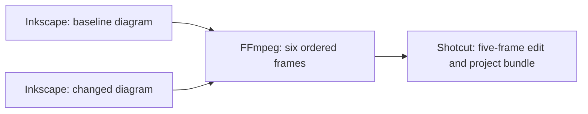

# From technical diagrams to an editable video

The [editable workflow](../examples/schemaxis/diagram-to-edited-video.json) joins
three bounded adaptors through verified artifact references:



The two diagrams use an 80 × 40 mm page at 127 dpi, producing 400 × 200 pixels.
Their first box changes colour. FFmpeg alternates these PNGs into six lossless
frames at 12 fps and requires the exact dimensions and frame count, half-second
duration within the default 0.002-second tolerance, and zero decoded RGB error.
Shotcut selects source frames `[1,2]` followed
by `[0,1,2]`, producing five frames at 12 fps. The first two diagram jobs may run
concurrently; their native Inkscape sessions have independent application IDs and
profiles.

Configure the installed applications through the ordinary private configuration:

```sh
PYTHONPATH=src python3 -m schemaxis configure inkscape /absolute/inkscape
PYTHONPATH=src python3 -m schemaxis configure ffmpeg /absolute/ffmpeg
PYTHONPATH=src python3 -m schemaxis configure shotcut /absolute/Shotcut.app/melt
PYTHONPATH=src python3 -m schemaxis run \
  examples/schemaxis/diagram-to-edited-video.json --output-directory new-diagram-video
PYTHONPATH=src python3 -m schemaxis verify new-diagram-video
```

Use Shotcut's portable `melt` wrapper with its matching `ffmpeg` and `ffprobe`
beside it. The separate FFmpeg provider also needs a matching FFprobe sibling.
Application locations remain outside the authored workflow. No source media or
machine paths need to be substituted into this example: consumer inputs resolve
from verified producer publications.

The final Shotcut run publishes `video.mkv`, `project.mlt` and
`project-bundle.zip`, in that order. Extract the bundle to keep the editable MLT
project together with its captured media. The independent native acceptance
checks relocation and rendering from that extracted bundle. Qualification uses
the MLT engine; it does not establish a Shotcut GUI editing roundtrip.

For the integration acceptance recipe, pass a private JSON configuration with
`version: 1` and `locations` entries for `inkscape`, `ffmpeg` and `shotcut`:

```sh
PYTHONPATH=src python3 tools/qualify_diagram_video.py \
  --config /absolute/private-config.json --output-directory evidence/diagram-video-check
```

The recipe verifies native results, exact selected frame ranges, four-job resume,
rejection of a changed producer PNG, and failure propagation. Demanding seven
frames from the six-frame encoding must fail with an unmet media requirement;
the dependent edit must never launch. Source, document and recipe identities are
retained in the qualification report.

This is a short technical-publication exercise. It does not qualify audio,
transitions, resizing, creative editorial quality, colour management or general
interchange with other video editors. See the [Inkscape](inkscape.md),
[FFmpeg](media-workflows.md) and [Shotcut](shotcut.md) guides for exact limits.
