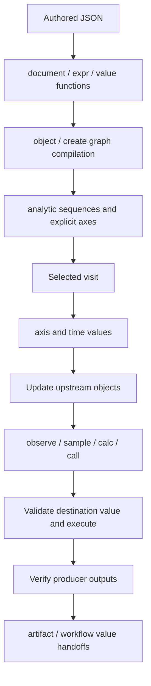

# Shared `$` authoring reference

Code snapshot: 2026-10-06. [ParaView guide](paraview-guide.md) · [Function signatures](paraview-settings-reference.md#registered-value-functions) · [Authored schemas](schema-guide.md) · [Common adaptor runtime](adaptor-runtime.md).

These are JSON value markers, not shell commands or general-purpose scripting. A marker replaces an entire value and preserves its resulting JSON type. Do not interpolate markers inside strings. Support depends on document route and placement: shared composition is widespread; ParaView graph observations, field sampling and inline object construction require the appropriate graph/native context. A valid marker can still produce an invalid value for its destination.

## Complete inventory and evaluation phases

| Marker | Purpose | Resolution context |
| --- | --- | --- |
| `$document` | Reuse JSON by pointer | Authored document / workflow scopes. |
| `$expr` | Closed composition or arithmetic | Authored values; may defer while workflow inputs are pending. |
| `$value` with `args` | Invoke registered pure typed function | Authored value resolution. |
| `$value` with `path` | Read verified upstream operation result | Workflow execution, after producer verification. |
| `$analytic` | Generate a value or camera sequence | Scheduled study/graph binding. |
| `$axis` | Read selected sweep value | Current graph/workflow visit. |
| `$time` | Read simulation time | Graph native visit. |
| `$observe` | Read updated upstream object metadata | Graph native visit. |
| `$sample` | Read numeric field tuple/component | ParaView native visit. |
| `$calc` | Closed runtime arithmetic/vector/bounds operation | Graph visit after resolving arguments. |
| `$call` | Invoke registered function with runtime arguments | Graph context; explicitly declared functions only. |
| `$object` | Reference an existing process-local graph object | Supported graph input/object context. |
| `$create` | Declare an inline graph node | Supported graph authoring input. |
| `$artifact` | Select verified producer artifact | Workflow handoff. |
| `$resource` | Read a digest-pinned captured input snapshot | Workflow planning, execution and verification; adaptor reader policy. |
| `$fill` | Retain an unfilled draft value | Authoring/templates; must be filled before ordinary execution. |

`$schema`, `$defs` and `$ref` are JSON Schema keywords in schema documents, not Schemaxis runtime commands. `$proxy` in catalogue gap records is metadata about recursive proxy choices, not authored executable syntax. `$selected` in diagnostic paths is internal traversal notation. Dollar-prefixed strings in foreign file formats are not new Schemaxis commands.



## `$document`: pointer reuse

```json
{"$document":"/dimensions/radius"}
```

`$document` is a string pointer. Absolute pointers address the current document. `/nodes/0/options/radius` selects a list member; `~1` escapes `/`, and `~0` escapes `~`. A relative `./radius` or `../dimensions/radius` is resolved from the marker's containing object/array at its definition site. Missing targets, malformed escapes, root escapes and cycles fail. Referenced values are copied, not shared mutable Python objects. The ordinary marker contains only `$document`.

```json
{"dimensions":{"radius":2},"definitions":{"diameter":{"$expr":{"op":"multiply","args":[2,{"$document":"/dimensions/radius"}]}}}}
```

Workflow forms additionally accept `operation` or `scope`:

```json
{"$document":"/dimensions/radius","operation":"makePart"}
```

```json
{"$document":"/dimensions/radius","scope":"workflow"}
```

`operation` selects a known workflow operation's authored document; it does not read a native result. `scope` accepts only `workflow`. Do not combine `operation` and `scope`. Inside an operation document an unqualified absolute pointer is local to that document; workflow scope explicitly accesses the envelope. Relative paths retain definition-site behaviour. [Implementation](../src/schemaxis/core/documents.py), [workflow scope handling](../src/schemaxis/adaptor_runtime.py).

## `$expr`: every closed authored operation

```json
{"$expr":{"op":"multiply","args":[2,3]}}
```

The wrapper contains only `$expr`. Its value contains `op`, `args` and optional `conflict`. `args` is exactly two values and may itself contain markers. `conflict` is accepted only for merge/namedMerge; values are `left` (default), `right`, `error`.

| `op` | Example arguments | Meaning |
| --- | --- | --- |
| add | `[2,3]` | Scalar sum: 5. |
| subtract | `[7,2]` | Scalar difference: 5. |
| multiply | `[2,3]` | Scalar product: 6. |
| divide | `[6,2]` | Scalar quotient: 3; zero division fails. |
| concat | `[[1],[2]]` or `["a","b"]` | Concatenate two arrays or two strings. |
| overlay | `[{"a":1},{"a":2,"b":3}]` | Shallow object overlay; right replaces shared keys. |
| merge | `[{"a":{"x":1}},{"a":{"y":2}}]` | Recursive object merge; arrays/scalars are atomic. |
| omit | `[{"a":1,"b":2},["a"]]` | Remove direct keys; right may also be an object whose keys are removed. |
| get | `[{"a":1},"a"]` or `[[5,6],1]` | Select existing direct object key/list index. |
| namedMerge | `[[{"name":"a","x":1}],[{"name":"a","y":2}]]` | Merge named-object collections, keeping first collection order and appending new names. |
| namedGet | `[[{"name":"a","x":1}],"a"]` | Select one named object. |

Named collections require nonempty unique string names. Authored arithmetic takes two finite scalar numbers, not booleans or vectors; runtime `$calc` has separate vector rules. Merge conflict `error` rejects unequal atomic values with a location. [Implementation](../src/schemaxis/core/composition.py).

## `$value`: pure function form

```json
{"$value":"boundsCentre","args":{"bounds":[0,10,0,4,-1,1]}}
```

Exactly `$value` (registered name) and `args` (typed argument object) are required. This example returns `[5,2,0]`. Functions cannot name imports or arbitrary Python callables. Arguments resolve references/composition before invocation; pending workflow dependencies can defer evaluation. Result types are validated.

Registered functions: boundsCentre, boundsCentre3D, boundsExtend, boundsFrame, boundsSize, boundsUnion, directionVector, fitCamera, foamRegions, orbitCameras, rangeCentre, sinDegrees, slicePositions, vectorLength. Their complete argument key/value contracts, defaults, result contracts and syntax templates are in the [function appendix](paraview-settings-reference.md#registered-value-functions). `foamRegions` is registered by the ParaView adaptor but is a pure authoring helper.

## `$value`: workflow result form

```json
{"$value":"measure","path":"/someResultKey","visit":0}
```

`$value` is the earlier producer operation ID; `path` is an RFC 6901 pointer into the verified result, not a graph observation. `visit` is a nonnegative producer visit index (default 0). Optional `artifact` is a nonnegative artifact index to select a structured JSON artifact before pointer selection. An empty pointer selects the whole JSON value. The result shape depends on the producer; inspect its actual verified result/artifact before choosing a pointer. `someResultKey` is a placeholder, not a promised ParaView result field. `args` belongs to the other `$value` form and is not valid here.

References create workflow dependencies and require an earlier, verified producer. Data cannot be consumed merely because a native process produced a file. See [workflow validation](../src/schemaxis/workflow.py) and [common runtime](adaptor-runtime.md).

## `$analytic`: every built-in sequence type

The wrapper contains only `$analytic`. Its value requires `type`:

```json
{"$analytic":{"type":"values","values":[0.5,1,2],"sync":"size"}}
```

```json
{"$analytic":{"type":"linear","start":[0,0,0],"end":[0,0,2],"count":3,"sync":"position"}}
```

```json
{"$analytic":{"type":"orbit","start":0,"end":270,"count":4,"elevation":20}}
```

| Type | Keys | Behaviour |
| --- | --- | --- |
| values | `type`, `values`, optional `sync` | Nonempty arbitrary JSON sample array. |
| linear | `type`, `start`, `end`, `count`, optional `sync` | Inclusive linear samples; finite scalars or matching nonempty vectors. |
| orbit | `type`, `start`, `end`, `count`, optional `elevation` | Scalar azimuth angles in degrees converted to camera objects containing direction and up. |

`count` is positive and within the state limit. `count:1` requires equal endpoints. Orbit elevation defaults to 0 and lies strictly between -90 and 90 degrees; orbit does not accept sync. Its output is a **camera sequence**, appropriate for an image writer's whole `cameras` value, not a scalar angle or XYZ vector option.

Member analytics create scheduled axes. A shared nonempty `sync` string zips equal-length sequences; unequal lengths fail. Unsynchronized members expand independently. Camera-list analytics become explicit camera lists in graph compilation rather than unrelated geometry axes. The common runtime also schedules non-graph adaptor/workflow studies, with route-specific placement restrictions. Do not put executable analytics into metadata containers and assume they will be evaluated. [Implementation](../src/schemaxis/analytics.py).

## `$axis` and `$time`

```json
{"$axis":"offset","path":["position",2]}
```

`$axis` names a declared active axis. Optional `path` is an array of object keys/list indices (default `[]`) into the selected value. An axis declaration has `name` and either nonempty `values` or a `series` specification. In ordinary graph use the marker belongs in varying non-constructor node options. Common workflow studies also support declared study axes with their own placement rules.

```json
{"$time":true}
```

Exactly `$time:true` returns the current numeric simulation time. False or extra keys fail. This is not a request for source-time inspection; use top-level times/source/select for that.

## `$observe`: updated upstream metadata

```json
{"$observe":"data","path":["bounds"]}
```

`$observe` names a graph node; optional `path` selects observed metadata, default `[]` returns the observation object. This introduces a dependency so the producer is updated first. Bounds are six numbers `[xmin,xmax,ymin,ymax,zmin,zmax]`; other metadata is adaptor/native-type-dependent. Inspect the observed object before selecting additional paths. Missing paths and unavailable observations fail.

For example, a slice origin can be the observed bounds centre:

```json
{"$call":"boundsCentre","args":{"bounds":{"$observe":"data","path":["bounds"]}}}
```

## `$sample`: every key

```json
{"$sample":"data","association":"POINTS","field":"RTData","index":0,"component":0,"block":[]}
```

| Key | Meaning |
| --- | --- |
| `$sample` | Required upstream node ID; creates an update dependency. |
| `association` | Required POINTS, CELLS or ROWS. |
| `field` | Required nonempty numeric array name. |
| `index` | Required nonnegative tuple index; may itself be a runtime expression. |
| `component` | Optional nonnegative component index; omitted returns a scalar for a one-component array and a list for a multicomponent array. |
| `block` | Optional nonnegative index path into composite blocks; default `[]`. |

Missing fields, incompatible associations, out-of-range tuples/components and nonfinite values fail. Sampling requires native data; host planning alone cannot produce it. ROWS is useful for table datasets. A sample is indexed data, not spatial interpolation; use a declared probe/resampling operation for spatial sampling.

## `$calc`: every runtime operation

```json
{"$calc":"multiply","args":[{"$axis":"offset"},2]}
```

Exactly `$calc` and `args` are valid. Arguments recursively resolve graph runtime values.

| Operation | Arity | Meaning / example arguments |
| --- | --- | --- |
| vector | 3 | Build XYZ from three finite scalar arguments: `[1,2,3]`. |
| midpoint | 1 | Bounds centre: `[[0,2,0,4,0,6]]` → `[1,2,3]`. |
| boundsMin | 1 | Lower XYZ from six-component bounds. |
| boundsMax | 1 | Upper XYZ from six-component bounds. |
| add | 2 | Scalar/vector addition; `[1,2]` → 3. |
| subtract | 2 | Scalar/vector subtraction; `[3,1]` → 2. |
| multiply | 2 | Scalar/vector multiplication; `[[1,2,3],2]` → `[2,4,6]`. |
| divide | 2 | Scalar/vector division; zero division fails. |
| min | 2 | Scalar/vector elementwise minimum. |
| max | 2 | Scalar/vector elementwise maximum. |

Arithmetic combines matching arrays recursively or broadcasts a scalar across an array. Bounds operations require six finite components with each lower bound ≤ upper bound. Results must remain finite. [Implementation](../src/schemaxis/pipeline.py).

## `$call`: registered runtime functions

```json
{"$call":"vectorLength","args":{"vector":{"$axis":"position"}}}
```

`$call` names a registered function; `args` maps its declared parameters to literal/runtime values (defaults apply when arguments are optional). It uses the same typed registry as `$value` with args. In graph execution use it for `$axis`, `$time`, `$observe`, `$sample` or `$calc` arguments. Dependencies are inherited from arguments. It does not grant arbitrary Python execution or native reflection. Functions explicitly declared to use graph objects require an object registry/context; none should be inferred from a name.

## `$object` and `$create`: graph input convenience

```json
{"$object":"data"}
```

```json
{"$create":{"id":"inlineSource","filter":"sphere","options":{"radius":2}}}
```

The wrappers contain only their named key. `$object` identifies an existing compatible graph object. `$create` contains a node declaration with registered filter, typed options and inputs; compilation adds the node to the graph with explicit identity/dependencies. Put these where the authored graph schema permits object inputs. They do not turn arbitrary strings into executable code, import another file, or create durable workflow artifacts. Multiple input arrays can contain permitted inline declarations. [Implementation](../src/schemaxis/context.py).

## `$artifact`: verified workflow file handoff

```json
{"$artifact":"mesh","index":0}
```

Exactly `$artifact` (earlier workflow operation ID) and `index` (required nonnegative artifact index) select a producer artifact. The consumer's route must accept its kind and verify the handoff. Producer native handles never cross process boundaries. The index addresses retained verified artifact order; inspect it rather than assuming an image/mesh always occupies index 0. [ParaView-to-Blender example](../examples/schemaxis/paraview-to-blender.json).

## `$fill`: unfilled draft marker

```json
{"$fill":"caseFile","label":"OpenFOAM case","type":"string"}
```

`$fill` identifies the draft value still needed. Optional label is displayed to the author; optional type communicates the intended value kind (default json). Authoring can retain it, and validated template parameter targets can expose it. Ordinary execution rejects unfilled markers with UNFILLED_VALUES; resolve them through authoring/template bindings first. It is not a native default or an instruction to guess a file. [Implementation](../src/schemaxis/unfilled.py), [human input guide](human-input.md).

## Choosing the appropriate form

Use `$document` for authored JSON reuse; `$value` with args for pure authoring calculations; `$analytic`/`$axis` for scheduled variation; `$call`/`$calc` with `$observe`/`$sample` for updated graph data; and `$artifact`/`$value` with path for verified workflow outputs. Destination constraints still apply after every resolution. Constructor settings cannot become runtime-variable simply by wrapping them in a marker.
