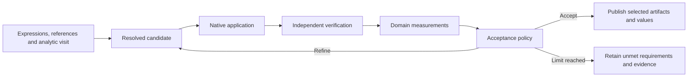

# Feedback studies over native applications

A strong adaptor exposes a domain model, meaningful controls, trustworthy
observations and a repeatable decision procedure. The shared expression and
analytic runtime prepares inputs. `schemaxis.feedback` adds a bounded feedback
procedure whose next action depends on verified observations.

The first policy is Gmsh's [mesh refinement and assessment](gmsh.md); FreeCAD now
uses the same controller for [bracketed geometric target studies](freecad-design-studies.md).
Native execution and scientific policies remain in their adaptors. The shared
controller has no app-name branches and imports no native applications.

## A framework for strengthening an adaptor

Treat the native application as a controllable, observable system. Its adaptor
should answer six questions in the user's domain:

| Question | Gmsh example | Responsibility |
| --- | --- | --- |
| What does the user mean? | Resolve a named boundary to a finer mesh region. | Adaptor domain model |
| What can change? | Global size, boundary size and transition distance, all in mm. | Adaptor controls; common expressions/references supply values |
| What was achieved? | Measured edge lengths, shape quality and CAD-volume discrepancy. | Adaptor observations, independently checked where possible |
| What counts as acceptable? | Explicit resolution, quality and cell-budget requirements. | User requirements interpreted by the adaptor |
| What happens next? | Accept, refine, or stop at an explained limit. | Adaptor policy within the shared feedback controller |
| Can another operation trust it? | Publish the selected mesh and measurements with replayable evidence. | Adaptor verification plus common provenance and workflow handling |

A broad API catalogue answers mainly the second question. A stronger adaptor
connects all six. Common expressions and analytics are infrastructure; domain
observations and policies give that infrastructure useful meaning. Strength is
best assessed against a named workflow and acceptance evidence, rather than a
percentage of the native application's API exposed.

The black-box boundary does not require every application to keep one process
alive. The current common backend uses isolated native visits; graph adaptors
retain their existing incremental execution. Documents are recipes, verified
value references are measurements, and artifact references are durable data.
They can all supply inputs without becoming interchangeable: units, provenance,
losses and adaptor-specific validation still govern their interpretation.

An outer analytic study enumerates requested conditions. An inner feedback policy
chooses subsequent actions from measured results. Gmsh now demonstrates both
layers together. Avoid giving every adaptor a mesh-like shrinking rule: some
applications need constraint solving, scenario comparison or discrete state
exploration instead.

Native execution or verification failures terminate the procedure as faults;
they do not enter the ordinary refinement branch.

## Policy boundary

An installed, trusted policy provides:

- `limit`: a finite iteration bound from 1 to 20.
- `describe()`: the declared policy, controls and limits retained in the report.
- `propose(history)`: the next complete application document, or `None` when its
  domain parameter bound prevents another proposal.
- `judge(candidate, observation, history)`: `accepted`, explanatory `checks`, and
  an optional domain `stop` reason.

These methods must be deterministic functions of the authored policy settings
and supplied history. They are called again during verification; they must not
depend on a mutable call counter, wall-clock time, uncaptured external data or
unrecorded randomness. Runtime observations belong in the verified attempt
record. Proposal/judgement callbacks receive copies of inputs and history.

The executor receives native-run, native-verification and observation callbacks.
It executes each proposed document in a fresh attempt, verifies it before reading
observations, and only then asks the policy to judge it. A native execution error
cannot silently become a rejected scientific candidate. Cancellation and a total
wall-clock limit bound the procedure. Failed attempts preserve earlier evidence.

Histories retain inputs, observations, decisions and native publications. On
verification, the controller regenerates proposals and decisions from the authored
policy and independently reverified attempts. Missing, altered, reordered or extra
attempts fail. Only an accepted candidate is published for downstream consumption;
completed unmet studies retain JSON and HTML explanations.

`schemaxis.feedback/1` is an execution receipt protocol, not a new authored input
version. Policies belong to adaptors; the engine does not interpret free-form
objectives, execute authored code, invent scientific thresholds or infer units.
Another adaptor can reuse this execution and verification machinery while defining
its own observations and domain policy.

## What is implemented and what remains

Implemented: bounded sequential feedback, first-acceptable selection, explicit
unmet outcomes, native verification before observation, decision replay, retained
rejected evidence, machine/human reports and ordinary whole-workflow reuse.

Gmsh implements geometric reduction of target sizes, independently measured mesh
quality, named-boundary sizing and acceptance requirements. It does not estimate
PDE solution error or claim mesh independence. Solver-driven convergence would
require a separately specified measured quantity and solver execution.

General optimisation, arbitrary cyclic workflows, rollback of a persistent native
session and resuming a partial feedback history are not implemented. FreeCAD now
has [bounded semantic edge selections](freecad-selections.md), including explicit
ambiguity failures and native re-selection after input changes, named geometric
measurements and bounded one-parameter target search. General constraint-based
design remains subsequent domain work.

## Candidate abstractions for the other adaptors

The table distinguishes bounded additions from proposed directions. A measured
acceptance check is not an automatic search policy. Each extension needs a bounded
exemplar and an independent acceptance criterion before adding native API surface.

| Adaptor | Useful domain abstraction to investigate |
| --- | --- |
| ParaView | A measurement study with explicit sampling locations, time/state correspondence and field comparability; connect pipeline exploration to an accountable engineering result. |
| FreeCAD | Named design features, semantic selections and geometric constraints that survive declared parameter changes or fail with explained ambiguity. |
| Blender | A deliverable with geometry, appearance and render budgets; compare candidates using declared image/geometry measurements. |
| Gmsh | Implemented here: named-region resolution, measured quality and bounded refinement; a later extension could measure solver-output convergence. |
| Cantera | A thermochemical operating envelope with explicit admissibility and conservation checks, plus locating crossings of a declared property threshold. |
| ngspice | Implemented: [named sampled voltage/gain requirements](ngspice.md), worst conditions, signed margins and unmet-publication blocking; common analytics vary declared components. Continuous envelopes and all-tolerance guarantees remain future work. |
| Octave | A numerical experiment that reports approximation error or sensitivity and a stated stopping criterion, rather than only invoking numerical functions. |
| Calc | A scenario model with declared inputs, outputs, units and reconciliation invariants; show which dependencies explain a changed result. |
| QGIS | A spatial question with explicit coordinate systems, spatial relations, coverage and geometry-validity requirements. |
| FFmpeg | Implemented: [deliverable requirements](media-workflows.md) for dimensions, frames, timing, bytes and decoded RGB error. Bounded candidate encoding and measured trade-off search remain future work. |
| Inkscape | Implemented: [technical diagrams](inkscape.md) with page, clearance and native text-fit budgets; dependency flows derive deterministic card placement. Arbitrary routing and aesthetic optimisation remain future work. |
| Shotcut | Implemented bounded [timeline cuts](shotcut.md): named source ranges, measured duration and independently selected decoded frames. Editorial decisions, transitions and audio remain future work. |
| Aseprite | An animation-state set with shared palette, attachment anchors and frame consistency requirements. |
| Godot | A scenario and observable behaviour contract over scene states, distinguishing native object construction from demonstrated behaviour. |

## Why FreeCAD needs a separate undertaking

The current solid route already has linked native features, profiles, booleans,
sweeps, finishing and verified exports. Finishing still selects one-based edge
indices from a particular topology. The assembly route separately supports a
bounded fixed tree; it does not establish arbitrary joint or motion support.
See [solid workflows](cad-and-mesh-workflows.md) and
[assembly limits](freecad-assemblies.md#limits-and-provenance).

The first bounded improvement now names geometric intent, for example the four
vertical outer edges of a box within a declared coordinate tolerance. Each
candidate resolves that selector again, records every match and requires an
explicit cardinality. Changing dimensions must either select the intended set
again or report zero/ambiguous matches. It must never silently substitute a nearby
edge. Initial acceptance cases should include dimensional changes, translation,
deliberate ambiguity, disappearing features and STEP export/reimport.

That is different from general persistent topological naming. Booleans and
finishing can split, merge or remove faces and edges. Geometric predicates alone
cannot recover every feature's history. A broader solution needs feature lineage,
selection provenance and an explicit policy for topology changes. STEP exchanges
also lose editable feature history; a named selection needs a checked handoff
representation before another adaptor can rely on it.

Constraint-based design adds another layer: distinguish solved, underconstrained,
overconstrained and geometrically invalid models; expose measured residuals and
failure reasons; then validate the saved native document after recomputation.
Constraints such as clearance or wall thickness need their own geometric
definitions and trustworthy measurements. A successful CAD recompute alone is
insufficient evidence of those requirements.

Recommended sequence: (1) bounded semantic selectors and selection diagnostics
(implemented for finishing edges);
(2) [named measurements as verified publications](freecad-measurements.md)
(implemented for bounded geometric quantities); (3) a small design study with
explicit geometric requirements (implemented for a bracketed scalar target);
(4) broader sketch constraints and assembly
relations only after their independent contracts are established. Reuse the shared
feedback engine at step 3. Preserve the ability to inspect failures before
attempting more complex optimisation. No percentage of "FreeCAD complete" is
meaningful until that larger scope is agreed.
