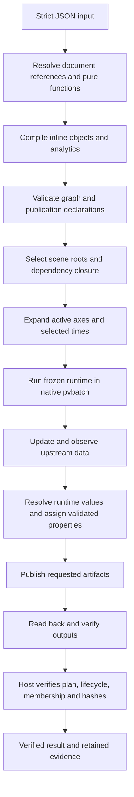
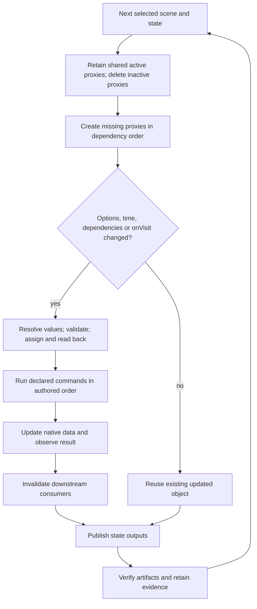
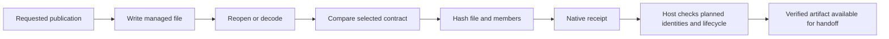

# ParaView adaptor documentation guide

Code snapshot: 2026-10-06. This guide describes Schemaxis's registered ParaView input contract (`schemaxis/1`), captured against ParaView 5.13.3. A document version is not an upstream application version. Coordinates and field units come from the dataset; no unit conversion is implied.

## Reading map

- [Complete operation reference](paraview-operation-reference.md): all 645 identifiers, every input port, option, nested proxy choice, command, output kind, declaration gap, and syntax example.
- [Settings and function signatures](paraview-settings-reference.md): complete camera/direction grammar, appearance constraints, and all registered value functions.
- [Shared `$` language](dollar-reference.md): references, expressions, functions, analytics, inline objects, workflow handoffs and draft placeholders.
- [Machine-readable authored schema](generated/paraview.authored.schema.json) and [expanded schema](generated/paraview.schema.json).
- [Catalogue qualification and extensions](paraview-catalogue.md), [parallel execution](parallel-execution.md), and [installation](installation.md).

There are 61 curated interfaces, 535 generated pipeline bindings, five resource bindings and 44 writer bindings. Some expose the same native algorithm. Curated names such as `slice` use Schemaxis options and defaults; generated names such as `pvSlice` preserve captured native spelling and usually omit defaults. Capitalisation matters: `input` and `Input` are distinct ports.

The operation appendix gives declared syntax examples for every operation and example values for every option. These are not 645 qualified scientific recipes. File readers need real files, filters need compatible fields/data, and native default values can be data-dependent. Where the retained declaration has no human property description, the appendix explicitly identifies the native property assigned rather than inventing a scientific interpretation. `coverage.gaps` identifies native properties not exposed in authored input.

## 1. Complete first workflow

Save this as `section.json` in the repository root:

```json
{
  "version": "schemaxis/1",
  "nodes": [
    {"id": "data", "filter": "wavelet"},
    {"id": "cut", "filter": "slice", "inputs": {"input": "data"},
     "options": {"normal": [0, 0, 1], "origin": [0, 0, 0]}}
  ],
  "scenes": [{
    "id": "section",
    "geometry": ["cut"],
    "visible": {"cut": {"field": ["POINTS", "RTData"], "legend": true}},
    "measurements": [{"node": "cut", "association": "POINTS"}],
    "images": [{"id": "view", "size": [640, 480],
                "cameras": [{"direction": [1, -1, 1]}]}]
  }]
}
```

From the repository root, use the CLI's `plan`, `run` and `verify` commands; `--help` lists their positional arguments and execution flags:

```sh
PYTHONPATH=src python3 -m schemaxis plan section.json
PYTHONPATH=src python3 -m schemaxis run section.json --output-directory /tmp/schemaxis-section-new
PYTHONPATH=src python3 -m schemaxis plan --help
PYTHONPATH=src python3 -m schemaxis run --help
PYTHONPATH=src python3 -m schemaxis verify --help
PYTHONPATH=src python3 -m schemaxis describe slice
PYTHONPATH=src python3 -m schemaxis schema --operation pvClip
PYTHONPATH=src python3 -m schemaxis functions
```

Planning/discovery do not import ParaView. Native execution uses a configured application installation in a separate process. The output directory must be new; the ordinary ParaView runner does not create missing parent directories. ParaView PATH management is unnecessary for authoring or host planning.



## 2. Every top-level input

JSON uses double quotes, no comments, no trailing commas, no duplicate keys and finite numbers. Unknown keys are rejected by closed contracts. IDs follow `[A-Za-z][A-Za-z0-9_-]*` and must be unique in their relevant namespace.

| Key | Syntax | Meaning / default |
| --- | --- | --- |
| `version` | `"schemaxis/1"` | Required ParaView document contract. |
| `nodes` | Nonempty array of node objects | Required definitions; dependencies determine execution order. |
| `scenes` | Nonempty array of scene objects | Required publication selections; each scene must request an output. |
| `axes` | `[{"name":"offset","values":[0,1]}]` | Optional named sweep sequences. Each axis has either `values` or `series`, never both. |
| `times` | `[0,1]` or `{"source":"case","select":"latest"}` | Explicit simulation times, default `[0.0]`, or selection from native source metadata. |
| `definitions` | JSON data | Reusable authored values addressed with `$document`. |
| `dimensions` | JSON data | Named design dimensions; values do not automatically set node options. |
| `views` | JSON data | Reusable view declarations; reference them explicitly. |
| `settings` | JSON data | Reusable authoring settings. |
| `maxStates` | Positive integer | Expansion limit, default `10000`. |
| `maxPublications` | Positive integer | Total planned output limit, default `10000`. |

Example reuse: `"dimensions":{"radius":2}` and a sphere option `"radius":{"$document":"/dimensions/radius"}`.

### Node fields and connection syntax

| Key | Syntax | Meaning |
| --- | --- | --- |
| `id` | `"cut"` | Required graph object identity. |
| `filter` | `"slice"` | Required registered operation name; this includes sources/resources. |
| `inputs` | `{"input":"data"}` | Named upstream connections. Required ports must be provided. Defaults to empty for sources. |
| `options` | `{"origin":[0,0,0]}` | Typed values for this operation; required values and defaults are operation-specific. |
| `onVisit` | `["ResetFieldCriteria"]` | Declared zero-argument commands in authored order before the node's native update. Only commands declared on that operation are valid. |

A single data port accepts `"producer"` or `{"node":"producer","port":1}`. Ports are zero-based; a string selects the default output. A multiple port accepts a nonempty array, e.g. `{"input":["a","b"]}` for curated `append`. Resource ports accept compatible graph node IDs, not numeric data ports. Authored graph inputs can also use `$object` and `$create`; see the shared section.

```json
{"id":"cut","filter":"pvClip","inputs":{"Input":"data"},
 "options":{"ClipType":{"type":"Plane","options":{"Origin":[0,0,0],"Normal":[1,0,0]}},"Invert":false}}
```

Nested proxy values contain `type` (a declared choice) and `options` (that choice's property object). These are typed data, not Python expressions. Generated top-level omitted options use native initialisation; omitted nested options on later visits retain native values. Specify varying nested properties explicitly.

Constructor options, especially reader filenames, are fixed across visits. Native resources preserve identity and participate in invalidation, but cannot be selected for dataset geometry or measurement publication. Data type and array requirements are checked after upstream data updates; host schema validity alone cannot establish those requirements.

### Axes and series

```json
{"axes":[{"name":"offset","series":{"start":-2,"end":2,"count":5}}]}
```

Use `{"$axis":"offset"}` in a varying option, e.g. inside a three-element slice origin. `values` can hold scalars, vectors or objects; select object members with `path`. Independent active axes form a Cartesian product. Unused axes do not expand a scene's geometry selection. Scene-only expressions may use active geometry axes, not introduce an unrelated presentation axis; use explicit camera lists for camera-only variation.

Series keys: `start` and `end` are numeric endpoints, `spacing` is distance between positions, `count` is a positive integer, `padding` is a nonnegative absolute bounds inset, and `paddingFraction` is a bounds inset fraction from 0 to 0.5. The general series resolver accepts any consistent combination of three of start/end/spacing/count, with optional bounds-derived endpoints. Ordinary standalone axes have no native bounds supplied, so provide enough explicit values. Example: `{"start":0,"spacing":0.5,"count":3}` produces `[0,0.5,1]`.

### Simulation time selection

```json
{"times":{"source":"case","select":{"values":[0.1,0.5],"tolerance":0.02}}}
```

The source must exist, have no connected inputs, and have constant options. Schemaxis inspects metadata after configuring it, then resolves the selection and replans. Exactly one selector is required:

| Selector | Example | Meaning |
| --- | --- | --- |
| String shorthand | `"latest"`, `"first"` | One latest/first stored time. |
| `latest` | `{"latest":3}` | Last n stored times; clamps to available count with a note. |
| `first` | `{"first":2}` | First n stored times. |
| `values` | `{"values":[0.2,0.8]}` | Nearest stored times; approximations reported. Ties choose lower time. |
| `valueRange` | `{"valueRange":[0.2,0.8]}` | Stored times within an inclusive range. |
| `indices` | `{"indices":[0,2]}` | Zero-based positions in supplied native time metadata. Invalid indices fail. |
| `indexRange` | `{"indexRange":[1,3]}` | Inclusive position range; high end may be shortened with a note. |
| `tolerance` | `0.01` | Optional maximum nearest-value mismatch; also expands valueRange endpoints. Not a separate selector. |

No stored times or an empty selection is a fault. Selected times are deduplicated and returned in time order, with provenance. Explicit `[0,1]` times do not perform this nearest-stored-time selection.

## 3. Every scene and output input

| Key | Syntax | Meaning / default |
| --- | --- | --- |
| `id` | `"result"` | Required unique scene ID. |
| `visible` | `{"cut":{"colour":"steelblue"}}` | Node-to-style map, default `{}`. Establishes renderable objects. |
| `geometry` | `["cut"]` | Automatic verified native dataset publications, default `[]`. |
| `measurements` | `[{"node":"integral","association":"POINTS"}]` | Numeric field CSV publications, default `[]`. Associations: POINTS (default), CELLS, ROWS. |
| `exports` | Array of explicit writer entries | Native format publications with readback/loss contracts, default `[]`. |
| `images` | `[{"id":"view","size":[640,480],"cameras":[{}]}]` | PNG outputs, default `[]`. Each writer requires unique id and nonempty cameras. |
| `appearances` | `[{},{"cut":{"opacity":0.5}}]` | Nonempty list of overrides on visible nodes, default `[{}]`; cannot introduce other nodes. |
| `gltf` | `true` | Visible scene glTF publication, default false. Bounded exporter support applies. |

Images/glTF require visible objects. Geometry, measurements and explicit exports do not. `visible` by itself is not a requested output. Geometry/measurement/export entries publish once per selected state. Images/glTF additionally multiply by appearances; PNG count also multiplies by each writer's camera count.

Per state: `geometry count + measurement count + export count + appearance count × (glTF enabled + sum of camera counts)`. Total publications sum each scene's count across its selected visits. Native handles and resources do not become durable cross-workflow artifacts.

### Appearance keys

| Key | Meaning / syntax / default |
| --- | --- |
| `colour` | Named retained colour or RGB/RGBA array; default `[0.7,0.7,0.7]`. Alpha multiplies opacity. |
| `field` | `["POINTS","U"]` or `["CELLS","p"]` selects array colouring; omitted means solid colour. |
| `component` | Integer ≥ -1; default -1 means magnitude; nonnegative selects vector component. |
| `opacity` | Number 0–1, default 1. |
| `representation` | Surface (default), Surface With Edges, Wireframe, Points, Outline. |
| `range` | Increasing `[min,max]`; omitted uses observed array range. |
| `legend` | Boolean, default false. |
| `legendTitle` | String; omitted uses field name. |
| `preset` | Native colour preset name; unavailable names fail. |
| `logScale` | Boolean, default false; requires a positive lower colour bound. |

```json
{"visible":{"cut":{"field":["POINTS","U"],"component":0,"range":[0.01,10],
 "preset":"Cool to Warm","legend":true,"legendTitle":"Velocity","logScale":true,
 "opacity":0.8,"representation":"Surface With Edges"}}}
```

Field existence and component count are checked natively. Constant observed ranges are widened for rendering. Camera/style runtime expressions resolve after upstream observations. [All exact constraints](paraview-settings-reference.md#appearance).

### Image and camera keys

Image writer `id` names the writer; `size` is `[width,height]`, default `[640,480]`, integer dimensions from 32 to 8192. `cameras` is a required nonempty array. An empty camera object uses camera defaults.

| Camera key | Meaning / default |
| --- | --- |
| `direction` | Side of focal point from which camera looks; default `[1,0,0]`. Accepts XYZ or the declared direction grammar (e.g. `"x+"`). |
| `up` | View-up direction, default `[0,0,1]`; must be nonzero and nonparallel to direction. |
| `focalPoint` | XYZ, default centre of visible bounds. |
| `parallel` | Boolean, default true for orthographic projection. |
| `scale` | Positive parallel half-height; omitted computes framing from bounds, padding and aspect ratio. |
| `distance` | Positive camera distance; omitted uses twice the bounds diagonal. |
| `bounds` | `[xmin,xmax,ymin,ymax,zmin,zmax]` framing override, each min ≤ max. |
| `padding` | Nonnegative framing fraction, default 0.1. |

```json
{"id":"views","size":[800,600],"cameras":[
 {"direction":[1,-1,1],"up":[0,0,1],"parallel":true,"padding":0.2},
 {"direction":"y-","focalPoint":[0,0,0],"distance":20,"scale":5}]}
```

Rendering sets the native view time to the selected pipeline time. PNG verification decodes the file, checks dimensions/scalars and rejects uniform pixels; it does not independently prove scientific correctness of the chosen colour map. Complete structured direction choices are in the [camera signature](paraview-settings-reference.md#camera).

### Explicit exports: every key

| Key | Syntax / meaning |
| --- | --- |
| `id` | Required unique export ID within scene. |
| `node` | Required data node ID; the writer's main data input. |
| `writer` | Required declared writer identifier, e.g. pvWriteXMLPolyDataWriter. |
| `options` | Writer-specific typed native values; default `{}`. |
| `resources` | Resource-port-to-node map; default `{}`; resource kinds must match. |
| `extension` | One declared extension; omitted chooses the first declared extension. |
| `comparison` | exact, geometry, pixels, table or semantic; omitted uses writer contract. |
| `tolerance` | Finite nonnegative number, default 0; exact requires 0. |
| `acceptLosses` | Explicit list of accepted loss categories, default `[]`. Must include all required by comparison. |
| `readback` | Optional `{"operation":"READER","options":{...}}` or null; selects declared reader with one file argument and no inputs. Filename is managed. |

```json
{"id":"mesh","node":"cut","writer":"pvWriteXMLPolyDataWriter",
 "options":{"DataMode":"Binary","CompressorType":"ZLib"},"comparison":"exact"}
```

```json
{"id":"surface","node":"cut","writer":"pvWritePSTLWriter",
 "comparison":"geometry","tolerance":0.000001,
 "acceptLosses":["fields","point-identity","interior-cells","structure"]}
```

| Comparison | Verified meaning | Required accepted losses |
| --- | --- | --- |
| exact | Structure, connectivity, values and storage types | none |
| geometry | Exterior geometry | fields, point-identity, interior-cells, structure |
| pixels | Image samples | coordinates, fields |
| table | Tabular values | topology, coordinates, structure |
| semantic | Mesh geometry and original fields, allowing container/storage changes | structure, point-identity, connectivity-order, storage-type |

Filenames, timestep selection and file-series controls belong to Schemaxis; do not supply FileName or time-series writer controls. Table exports and JSONImageWriter/HoudiniWriter use direct verifiers and reject a custom readback reader. JSONImageWriter requires pixels comparison. A writer may exist in the catalogue yet fail on a native format or unsupported dataset; explicit verification is mandatory.

Automatic geometry selects the supported VTK XML format for the observed native type (including supported table/composite/specialised types). glTF is a visible scene interchange, not an exact scientific dataset replacement. Measurements contain numeric arrays; they do not preserve arbitrary string columns. Every writer's extensions, defaults, loss contract and options appear in the [operation reference](paraview-operation-reference.md).

## 4. Lifecycle, ordering and invalidation



Scene roots include visible nodes, geometry/measurement/export nodes, writer resources and observation/sample dependencies. Only their closure executes. Graph cycles, unknown nodes and incompatible kinds fail. Independent sweeps form products; synchronized analytics zip matching samples. Surviving proxies retain native identity. Effective option changes invalidate the node and consumers. Time changes invalidate selected nodes. `onVisit` requests force updates and downstream invalidation even if time/options stay equal. At completion proxies are deleted in reverse dependency order.

## 5. Retained output and evidence

The ordinary serial runner retains these named files. Common runtime studies and MPI dispatch may wrap results with additional visit/batch evidence; use receipt identities rather than assuming one flat directory layout.

| File | Purpose |
| --- | --- |
| `authored.json` | Original submitted input. |
| `document-resolution.json` | Document references and pure-value resolution provenance. |
| `input.json` | Effective expanded pipeline input. |
| `analytic-bindings.json` | Member-to-axis/synchronisation bindings. |
| `plan.json` | Pipeline, selected scenes and expected publication count. |
| `runtime.zip` | Frozen execution code. |
| `submission.json` | Native subprocess submission evidence. |
| `verification.json` | Native states, events, artifact identities, readback evidence and status. |
| `result.json` | Final succeeded/failed status and summary. |
| `inspection.json`, `inspection-submission.json`, `time-selection.json` | Conditional native source-time inspection and selection evidence. |
| `submission-fault.json` | Structured execution failure, when applicable. |

Successful ordinary result keys: `status:"succeeded"`, `verified:true`, `directory` (absolute output directory), `artifacts` (count), `planDigest` and `runtimeSha256`. Failed results carry `status:"failed"`, `verified:false`, `directory` and `fault`. Faults identify a stable code, location and available recovery/observation information.

Artifact receipts contain `identity` (scene, timeIndex, indices, kind and kind-specific selectors), `file`, `sha256`, `verified`, and format-specific verification evidence. Geometry/measurement/export identities add `output` and `node`; exports add the export writer ID. Images add appearance, writer and camera indices; glTF adds appearance. Multi-file formats additionally retain member file hashes. Image receipts retain effective camera/appearance and view-time evidence; export receipts retain writer, comparison, tolerance, accepted losses, readback, effective options and resource identity evidence.



A file's existence or successful process exit alone is insufficient. Host verification checks publication order/membership, plan digest, states, effective settings, object reuse, update invalidation, commands and file hashes. Do not edit outputs and expect old hashes to remain valid. See [native job implementation](../src/schemaxis/adaptors/paraview/job.py) and [publication implementation](../src/schemaxis/adaptors/paraview/publication.py).

### Automatic geometry formats

| Observed native class | Extension |
| --- | --- |
| vtkPolyData | vtp |
| vtkUnstructuredGrid | vtu |
| vtkImageData | vti |
| vtkStructuredGrid | vts |
| vtkRectilinearGrid | vtr |
| vtkMultiBlockDataSet | vtm |
| vtkTable | vtt |
| vtkPartitionedDataSet | vtpd |
| vtkPartitionedDataSetCollection | vtpc |
| vtkHyperTreeGrid | htg |
| vtkHierarchicalBoxDataSet / vtkOverlappingAMR | vthb |

Other native types fail automatic publication explicitly. Empty geometry is normally rejected. MPI geometry uses its separate admitted parallel XML publication path.

### Native observation output keys

These are available to `$observe` and retained in each state's `observations` map:

| Key | Syntax / meaning |
| --- | --- |
| `points` | Native point count. |
| `cells` | Native cell count. |
| `bounds` | Six-component finite bounds; null for tables. |
| `fields` | Association → array name → `{components,range}`. POINTS/CELLS for datasets; ROWS for tables. |
| `dataType` | Native VTK class name. |
| `traits` | Observed semantic data traits; unknown performance/contiguity remains unknown. |
| `inputContracts` | Evidence from checking this object's connected native inputs. |
| `rows` | Native row count, tables only. |

Each array record's `components` is its component count; `range` is the native range, null for strings or nonfinite/empty ranges. A resource observation instead contains `kind`, `nativeIdentity` and `inputContracts`. Observation metadata is not a full copy of dataset arrays; use `$sample` for individual numeric tuples.

Example observation access: `{"$observe":"data","path":["fields","POINTS","RTData","range"]}`.

## 6. Worked examples and scope

| Example | What to inspect |
| --- | --- |
| [Catalogue mesh](../examples/schemaxis/paraview-catalogue.json) | Generated filter and nested native properties. |
| [Table](../examples/schemaxis/paraview-catalogue-table.json) | CSV reader, table round trip, row samples. |
| [Output ports](../examples/schemaxis/paraview-output-ports.json) | Selecting a non-default producer port. |
| [Resources](../examples/schemaxis/paraview-resources.json) | Shared lookup/opacity resource identities. |
| [Textures](../examples/schemaxis/paraview-textures.json) | File and pipeline-backed textures. |
| [Writer resources](../examples/schemaxis/paraview-writer-resources.json) | Lookup-table input to a writer. |
| [Writers](../examples/schemaxis/paraview-writers.json) | Format-specific explicit exports and loss contracts. |
| [Native times](../examples/schemaxis/paraview-native-times.json) | Metadata-driven source-time selection. |
| [Commands](../examples/schemaxis/paraview-commands.json) | Declared native command before update. |
| [Static mesh](../examples/schemaxis/paraview-static-mesh.json) | `pvForceStaticMesh` caches the first geometry; ParaView 5.13.3 offers no way to force recomputation. |
| [Admission line](../examples/schemaxis/paraview-admission.json) | Bounded analytic/lifecycle acceptance fixture. |
| [ParaView to Blender](../examples/schemaxis/paraview-to-blender.json) | Durable cross-adaptor artifacts. |

MPI support is bounded to admitted operations and whole-document constraints; it is not catalogue-wide qualification. Captured domains/metadata and generated bindings do not mean exhaustive native acceptance. The cell-grid probe example explicitly records an unqualified failing native fixture. Plugins/extensions are trusted developer-installed packages, never arbitrary authored import paths. See [catalogue scope](paraview-catalogue.md) for extension capture and qualifications.

## 7. Keeping this guide current

Regenerate the operation/settings appendices from current host declarations:

```sh
PYTHONPATH=src python3 tools/generate_paraview_guide.py
```

Then review this narrative against `schema.py`, `publication.py`, `writers.py`, `job.py`, `pipeline.py`, `adaptor_runtime.py`, and the shared authoring code. Generation does not launch ParaView or certify native algorithms. Native testing requires independently selected fixtures and readback evidence.
